# TestOrchestrator 2.7.0 — User Manual

Applies to **TestOrchestrator 2.7.0** (feature release — repository
discovery, inventory, and the Node.js frameworks Jest, Postman/Newman
and Bruno join the existing runners).

> **Draft notice:** this edition describes the 2.7.0 release candidate.
> Screenshots will be refreshed on the frozen build before release;
> provenance (head + sha256) is recorded in the Screenshot Index.

All screenshots were captured from a real Linux install of the
package or a seeded documentation instance of the same codebase —
always with safe demonstration data (see the Screenshot Index for
each frame's provenance). Application
screens show the **user's point of view** — captured as a
non-administrator account (Test Manager), so the navigation and
controls are exactly what a regular user sees; administrator-only
pages appear only where the text describes administrator setup and
are labelled as such. Where a fixture stood in for licensed
software, that is stated on the screenshot caption and in the text.

---

## Contents

- [1. Introduction](#1-introduction)
- [2. Projects and repositories](#2-projects-and-repositories)
- [3. Frameworks and framework projects](#3-frameworks-and-framework-projects)
- [4. Discovery and inventory](#4-discovery-and-inventory)
- [5. Running tests](#5-running-tests)
- [6. Step by step — suites, releases, and plans](#6-step-by-step--suites-releases-and-plans)
- [7. Connecting runtimes and running tests](#7-connecting-runtimes-and-running-tests)
- [8. Historical-result import](#8-historical-result-import)
- [9. Reports and evidence](#9-reports-and-evidence)
- [10. Fixture-vs-licensed statement for these screenshots](#10-fixture-vs-licensed-statement-for-these-screenshots)
- [11. Quick-start — your first run in fifteen minutes](#11-quick-start--your-first-run-in-fifteen-minutes)
- [12. Troubleshooting](#12-troubleshooting)
- [13. Frequently asked questions](#13-frequently-asked-questions)
- [14. Glossary](#14-glossary)

## 1. Introduction

### 1.1 What TestOrchestrator does

TestOrchestrator is a self-hosted portal that schedules, dispatches,
and records automated test runs for Katalon Studio projects:

- It checks out a bound Git repository, discovers test cases, test
  suites, and test-suite collections, and launches them through
  **Katalon Runtime Engine (KRE)**.
- Execution is delegated through **Buildbot** to registered
  **execution targets**, so tests run next to the KRE
  installation that owns them.
- Results — JUnit outcomes, logs, screenshots, and native Katalon
  reports — are collected back and stored as **evidence** attached to
  a durable **execution** record.
- **reportingLabs** generates a browsable HTML report per execution
  from the stored results.
- Katalon results that were produced elsewhere (an older CI job, a
  teammate's machine, an archive) can be **imported** into history
  with full provenance instead of re-run.

### 1.2 Components and their responsibilities

| Component | Role |
|---|---|
| **TestOrchestrator portal** | Web UI + API. Owns projects, Git bindings, users, the execution database, evidence, and reports. Serves the worker installer and the Linux worker archive to authenticated users. |
| **Buildbot master** | Bundled orchestrator (v4.3.0). Accepts dispatched jobs from the portal and hands them to the selected execution target. Its REST API is loopback-only. |
| **Execution target** | A local controller worker, a remote `buildbot-worker` (Windows/Linux), or an agentless SSH host. Managed entirely in Admin → Infrastructure. |
| **KRE** | Katalon Runtime Engine — the licensed test executor. It must be installed and licensed **on the worker/host** where the suite actually runs. TestOrchestrator invokes it; it does not license it. |
| **reportingLabs** | Bundled report generator (vendored, MIT). Converts stored results + evidence into a static HTML report per execution. |

The portal never executes tests itself when a remote runtime is
selected — the target does. The portal orchestrates, records, and
serves the results.

### 1.3 Live execution vs. historical-result import

Two paths create execution records:

- **Live execution** — a suite or collection is dispatched now: the
  worker checks out the bound revision, runs KRE, and returns
  results and evidence. Use this to *run* tests.
- **Result import** — an existing `Reports/` tree inside the bound
  repository is scanned at a chosen revision; matching JUnit output
  becomes imported executions with provenance (source commit, run
  directory, parser). Use this to *adopt* results that already exist.
  Importing cannot invent evidence that is not in the result files —
  it stores what is there and reports what is missing.

### 1.4 Signing in

Open the portal URL your administrator gives you (for example
`https://tests.example.com/`). You land on the sign-in page.

- On a **fresh installation** a bootstrap account `Admin`/`Admin`
  exists. The first sign-in with it is forced directly to the
  password-change form — you cannot navigate anywhere until a strong
  password (at least 12 characters) replaces the temporary one.

  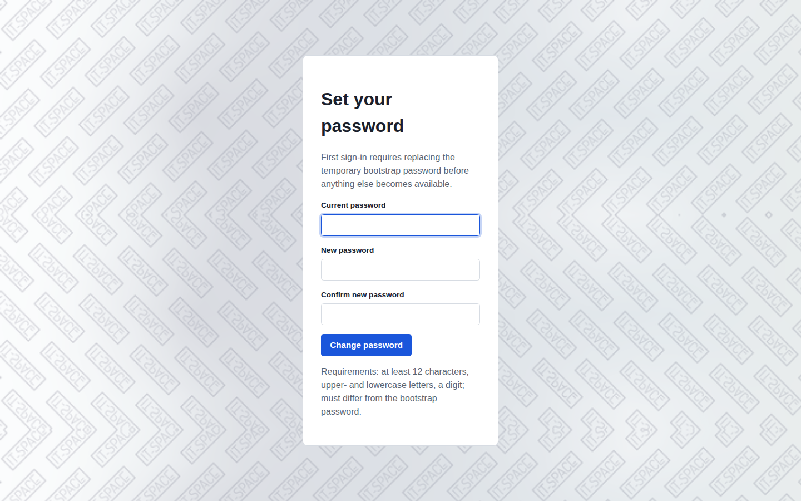
- Until the administrator marks setup complete and enables external
  access, the portal only accepts connections from the machine it
  runs on (loopback). If you get an unexpected `403`, ask your
  administrator — this is the intended gate, not an error.
- The portal only answers under its configured host names. Bookmark
  the address you were given rather than a raw IP.

Sign out with the sign-out control in the sidebar footer.

### 1.5 Roles and permissions

Four roles exist. The sidebar shows only what your role may use.

| Capability | Admin | Test Manager | Tester | PO |
|---|---|---|---|---|
| Sign in, view dashboard, projects, executions, reports | ✓ | ✓ | ✓ | ✓ |
| Queue executions (run suites/collections) | ✓ | ✓ | ✓ | — |
| Import historical results | ✓ | ✓ | — | — |
| Edit projects, bindings, schedules; delete executions | ✓ | ✓ | — | — |
| System pages: settings, users, workers, credentials, network, audit, logs | ✓ | — | — | — |

Passwords must be at least 12 characters. An administrator can reset
your password to a temporary value — you will be forced to replace it
at next sign-in (`must_change_password`).

### 1.6 Navigation

The left sidebar is the whole application:

- **Dashboard** — live tile overview (projects, active/queued
  executions, 30-day outcomes, worker eligibility) plus outcome and
  duration charts.
- **Projects** — your projects; each leads to bindings, discovered
  inventory, suites, schedules, imports, and releases.
- **Executions** — the global execution history with filters.
- **Admin** (administrators only) — Settings, Health & services,
  Network & certificates, Users, Workers & runtimes, Infrastructure,
  Credentials, Changelog, Audit, Operational Logs, Third-party
  notices & licences.

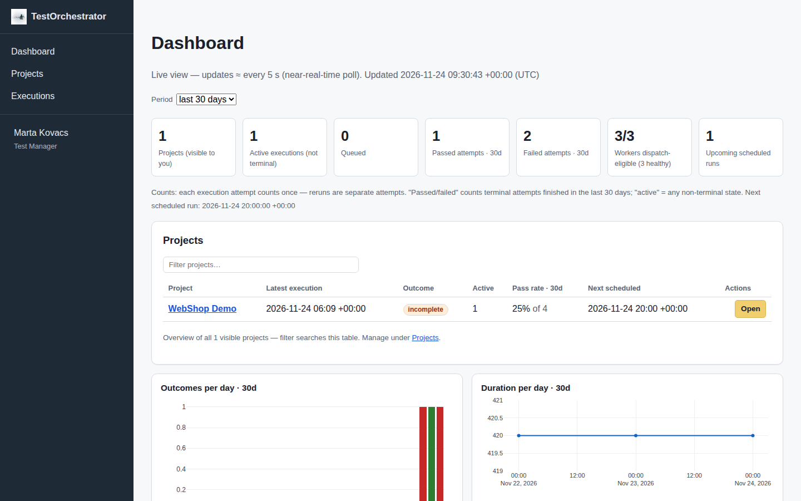

---

## 2. Projects and repositories

A **project** groups everything about one test codebase: its Git
binding(s), discovered inventory, executions, schedules, imports, and
report publication.

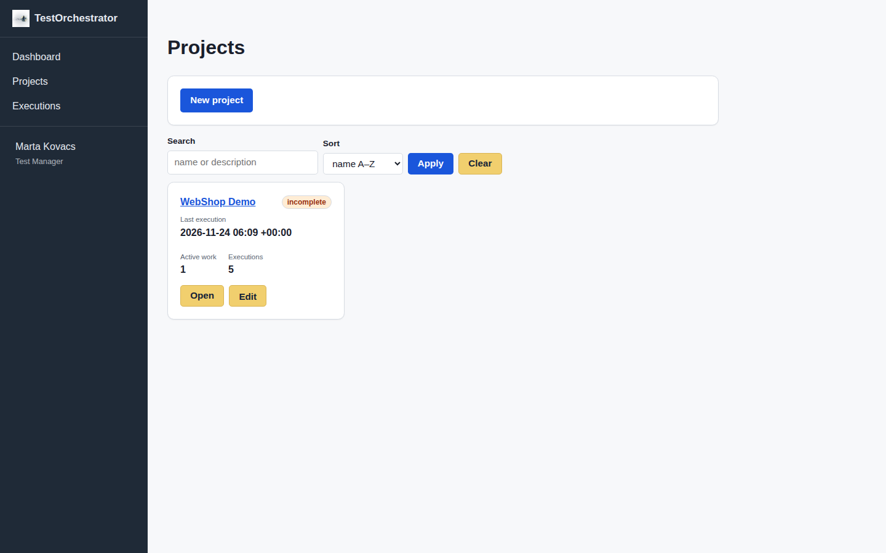

### 2.1 Creating a project

**Projects → New project.** Give it a name and optional description.
The project page then offers a **Git binding**: the repository that
contains the Katalon project.

### 2.2 Configuring a repository binding

On the project page, add a binding with:

- **Name** — a label for this binding (a project can have several,
  e.g. a sources repo and a results repo).
- **URL** — a remote Git URL (`https://…`, `git@…`) or a local path.
- **Ref** — branch, tag, or other ref the binding tracks
  (e.g. `master`).
- **Subdirectory** — optional path inside the repo that is the Katalon
  project root, if the repo holds more than the project.
- **Credentials** — for private repositories, reference a credential
  stored under **Admin → Credentials** (`git` kind: an HTTPS token or
  SSH private key). Stored values are write-only — they are never
  shown back, logged, or exported.
- **Report write-back** — off by default; an admin can explicitly
  opt a binding in to push generated `TestOrchestrator/Reports/`
  output back to a named branch. Read access is not publish
  permission — nothing is pushed unless this is enabled.

After saving, **sync** the binding. Sync clones/fetches into an
internal worktree and resolves the revision to an exact commit SHA —
every execution records that SHA, so runs are reproducible.

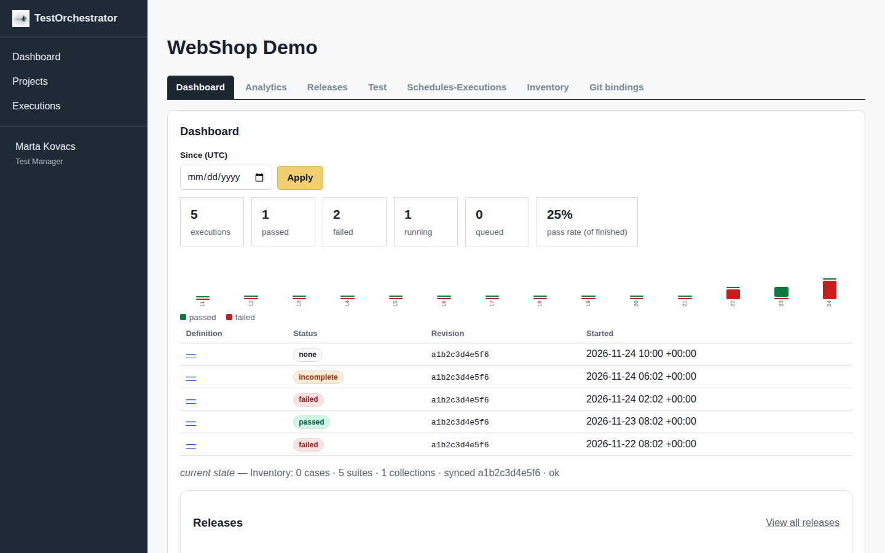

### 2.3 Discovery: what sync finds

After a successful sync the binding is scanned for a Katalon
project: exactly one `*.prj` file, `Test Cases/*.tc`,
`Test Suites/*.ts` (split into **suites** and **collections** by their
XML root element — not by file name), and `Profiles/*`. The
inventory is replaced atomically per resolved SHA: a failed sync
keeps the last good inventory marked stale rather than emptying it.

Typical diagnostics:

| Symptom | Meaning |
|---|---|
| `no Katalon .prj file found under the bound path` | The binding root or subdirectory does not point at a Katalon project. Fix the subdirectory. |
| `multiple .prj files` | The bound scope contains several projects — narrow the subdirectory. |
| `symlink escape skipped` | A link inside the repo pointed outside the checkout; it was ignored. |
| `bound worktree/subdirectory missing` | The binding was never synced, or the worktree was cleaned. Sync again. |

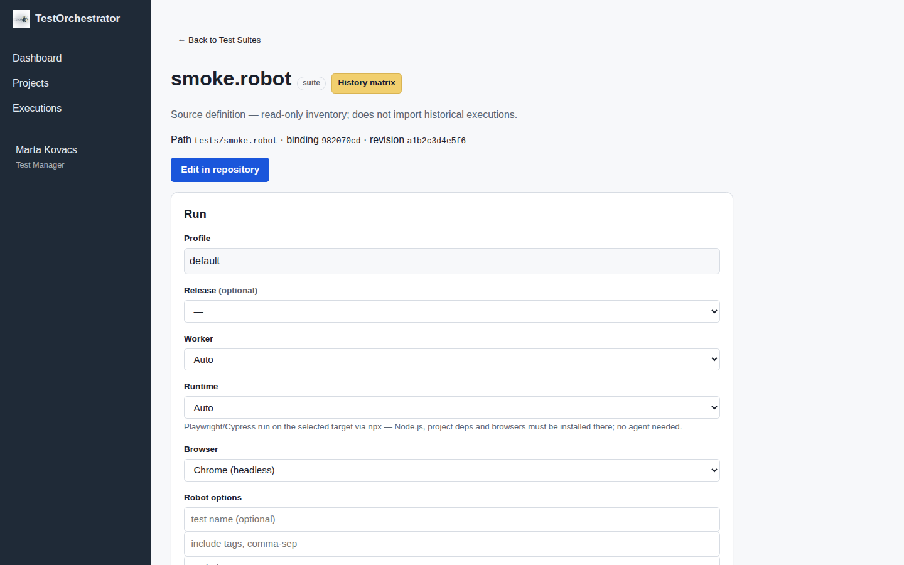

Repository access failures (authentication, unreachable host, bad
ref) surface on the binding with the underlying error. Check the URL,
the credential reference, and that the ref resolves — an invalid ref
reports `cannot resolve '<ref>'`.

> **Provider note.** Git hosting is accessed through a generic Git
> backend; HTTPS-token and SSH authentication are supported.
> **Azure DevOps repositories specifically are an open backlog
> item** — interoperability has not been validated because no
> authorized ADO host was available. Treat ADO URLs as unverified
> until that gate is closed.

### 2.4 Suites, schedules, and releases

- **Suites** — a portal-side grouping you can compose from discovered
  items, edit, and run as a unit.
- **Schedules** — recurring launches of a suite/collection; they can
  be toggled, edited, or triggered once on demand.
- **Releases** — a scoped set of items tracked toward a release with
  its own run and status view.

Step-by-step procedures for all three are in §3.

---

---

## 3. Frameworks and framework projects

*New in 2.7.0.*

### 3.1 What a framework is

A **framework** is the test tool your tests are written for —
pytest, Robot Framework, Jest, and so on. TestOrchestrator supports
twelve frameworks:

| Framework choice in the UI | What it is, in plain words | Pick this when… (example) |
|---|---|---|
| Katalon Studio | the Katalon Runtime Engine — a commercial tool that needs its own licence | your team records tests in Katalon Studio |
| pytest | the standard Python test runner | your tests are Python files with `test_` functions |
| pytest-bdd | pytest plus feature files written in plain sentences | your Python tests follow the given/when/then style |
| Behave | a Python framework that runs plain-sentence feature files | your team writes behaviour specs in Gherkin |
| Robot Framework | a keyword-driven framework — tests read like spreadsheets of steps | your tests use Robot's keyword libraries |
| Cypress | browser tests written in JavaScript with the Cypress tool | your team writes Cypress specs for the web UI |
| Playwright Test (JS/TS) | Playwright's own JavaScript test runner | your browser tests use `@playwright/test` |
| Playwright via pytest | Playwright browser tests driven through Python pytest | your team writes browser tests in Python |
| GoogleTest (C/C++) | compiled C++ test programs | your tests are built into a binary with CMake |
| Jest (Node.js) | the Jest JavaScript test runner | your project has `*.test.js` files |
| Postman collections (Newman / Postman CLI) | API test collections exported from Postman | you test REST APIs with Postman |
| Bruno collections (bru CLI) | API test collections in Bruno's file format | you test REST APIs with Bruno |

You always pick the framework yourself. TestOrchestrator may
*suggest* a framework after looking at your repository, but the
suggestion never overrides your choice.

### 3.2 What a framework project is

A **framework project** is the combination of: one of your projects,
one framework, and the place in the repository where those tests
live. One project can have several framework projects — for example
a pytest suite at the repository root and a Postman collection in an
`api/` folder.

Each framework project carries:

- the **framework** (your choice from the table above),
- the **project root** — the folder inside the repository where the
  tests live, relative to the repository root (empty means the
  repository root itself),
- **framework settings** — framework-specific options described in
  §3.4,
- a **discovery status** — the state of test discovery for this
  framework project (see chapter 4),
- the discovered **inventory** — the individual tests TestOrchestrator
  knows about.

### 3.3 Creating a framework project — step by step

1. Open your project from the Projects list.
2. Open the **Frameworks** section and choose **Add framework project**.
3. Pick the framework in the **Framework** dropdown. The dropdown
   lists the twelve choices from the table in §3.1.
4. Fill in **Project root** if the tests live in a subfolder.
   *Worked example:* your repository layout is `api/` for Postman
   collections and `tests/` for pytest — create two framework
   projects, one with project root `api`, one with `tests`.
   *Common mistake:* entering an absolute path like `/home/me/repo/api`.
   The project root is always relative to the repository, never an
   absolute path on your computer or on the runner. A root that tries
   to escape the repository checkout is refused with an error.
5. Save. TestOrchestrator runs **static discovery** immediately (see
   chapter 4) and shows what it found.

**Expected result:** the framework project appears in the Frameworks
section with its discovery status and item count.

**What if it doesn't work:** if discovery reports zero items, check
the project root first — most often the tests are in a different
folder than the one configured. Chapter 4 explains the discovery
statuses and their meanings.

### 3.4 Framework settings reference

Settings are per framework project. All of them have safe defaults;
you only set what you need.

#### Postman (Newman / Postman CLI)

| Setting | What it does | Allowed values | Default |
|---|---|---|---|
| `engine` | which CLI runs the collection | `newman`, `postman-cli` | `newman` |
| `environment_file` | Postman environment JSON — fills `{{variables}}` | path in repo | empty |
| `globals_file` | Postman globals JSON | path in repo | empty |
| `data_file` | iteration data file (CSV/JSON) | path in repo | empty |
| `iterations` | how many times the collection runs | positive integer | 1 |
| `delay_ms` | delay between requests | milliseconds | 0 |
| `timeout_ms` | request timeout | milliseconds | engine default |
| `insecure` | disables TLS certificate verification | `true`/`false` | `false` — verification ON |
| `capture_bodies` | include raw request/response bodies in artifacts | `true`/`false` | `false` — bodies stay out |

*Worked example:* your collection uses `{{host}}` everywhere. Put
`postman/local.postman_environment.json` in **environment file** and
the variable resolves at run time. *Common mistake:* forgetting the
environment file — requests then go to the literal text `{{host}}`
and fail in milliseconds. If every request fails almost instantly,
check the environment file first.

*Security note:* only turn on `insecure` for test servers with
self-signed certificates. Never for production endpoints.

#### Bruno

| Setting | What it does | Allowed values | Default |
|---|---|---|---|
| `environment` | environment name (`--env`) | a name defined in the collection's `environments/` folder | empty |
| `environment_file` | environment file (`--env-file`) | path in repo | empty |
| `collection_roots` | folders that are collection roots (contain `bruno.json`) | list of paths | scan automatically |
| `iterations` | run count | positive integer | 1 |
| `include_tags` / `exclude_tags` | tag filters | tag names | empty |
| `delay_ms` | delay between requests | milliseconds | 0 |

*Worked example:* your collection defines an environment `local` in
`environments/local.bru` — set **environment** to `local`.
*Common mistake:* Bruno only runs **at the collection root** — the
folder containing `bruno.json`. If runs fail with "You can run only
at the root of a collection", the project root must point at the
collection root folder, not above or below it.

#### Jest

| Setting | What it does | Allowed values | Default |
|---|---|---|---|
| `test_path_pattern` | which test files run | jest path regex | all |
| `test_name_pattern` | which tests inside files run (`-t`) | jest name regex | all |

Jest configuration is read literally from `jest.config.*` and the
`package.json` `jest` object — JavaScript config files are never
executed during discovery.

#### All other frameworks

pytest, pytest-bdd, Behave, Robot Framework, Cypress, Playwright,
GoogleTest and Katalon carry their 2.6.0 settings unchanged — see
the framework sections in chapter 5.

---

## 4. Discovery and inventory

*New in 2.7.0.*

### 4.1 What discovery is

**Discovery** is how TestOrchestrator learns which tests exist in
your repository. The result of discovery is the **inventory** — the
list of individual tests you can select, run and schedule.

Discovery happens automatically when you create a framework project
or sync the repository, and you can re-run it any time with the
**Rediscover** action on the framework project.

### 4.2 The two kinds of discovery

**Static discovery** is the default and runs automatically.
TestOrchestrator reads the test files and parses their structure —
for example the JSON of a Postman collection or the names in a
pytest module. Static discovery:

- never executes any of your repository's code,
- never installs dependencies,
- never sends API requests,
- runs inside the application, bounded in time and memory.

Scripts inside your tests (Postman pre-request scripts, Bruno
scripts, jest setup files) are *repository code*. Static discovery
flags their presence but never runs them.

**Native collection** is the alternative: the framework's own tool
(`pytest --collect-only`, `jest --listTests`, …) lists the tests on
an isolated runner. Native collection:

- runs only when you explicitly ask for it — never automatically,
  never from a schedule,
- may execute repository code, because the framework tool itself
  loads your test modules,
- for Jest, installs dependencies first — see the security note in
  §4.5.

Use static discovery unless you have a reason: some frameworks only
reveal their real test list by executing (dynamic pytest fixtures,
jest projects with generated tests). For Postman, Bruno and Katalon
static discovery is authoritative — native collection is refused
for these frameworks with a message telling you to use static
discovery, because their structure is fully visible without
executing anything.

### 4.3 Discovery statuses

Each framework project shows one of these statuses:

| Status | What it means, in plain words | Example of what you see | What to do |
|---|---|---|---|
| `ok` | the scan finished and your tests are listed | "12 tests found" in the inventory | nothing — you can select and run tests |
| `checking` | the scan is running right now | a spinner on the framework project | wait a minute and refresh |
| `draft` | the project was saved but not scanned yet | you just created the project | saving triggers a scan automatically; use Rediscover if needed |
| `failed` | the scan itself went wrong (not your tests — the scan) | an error like "repository unreachable" | read the error on the framework project page, fix the cause, then Rediscover |
| `not-checked` | no scan has run yet | a freshly imported project | use Rediscover |

A refused native collection (§4.2) is not a failure — it never
changes the discovery status.

### 4.4 The inventory — what the item list means

Open a framework project to see its inventory. Each row is one
discovered item with:

- its **name** and **path** inside the repository,
- its **granularity** — whether you can run it individually.
  Cypress, for example, is file-level only: you can run a spec file
  but not a single `it()` inside it, because the Cypress runner
  cannot select that finely. Postman requests are never individually
  selectable (neither engine can run one request); folders are
  selectable only when their name is unique in the collection.
  Bruno items are path-addressed, so duplicate names across folders
  stay unambiguous.
- a **selectable** marker — items you can pick for a run,
- the **provenance** — `static` or `native`, how this item was
  discovered,
- a **stale** badge when the item no longer matches the current
  repository content (for example the test was renamed upstream).
  Stale entries are never dropped silently — they stay visible with
  the warning until a rediscovery refreshes the inventory.

Items marked as **candidates** (for example individual jest test
names) are informational: jest's `-t` filter is a regex over the
full test name path, so individual-test selection becomes available
only when native collection has proven the identity is unambiguous.

### 4.5 Jest dependency preparation — what you need to know

Jest tests usually depend on packages installed by npm
(`node_modules`). Two kinds of discovery behave differently:

- **Static discovery** never installs anything — it reads config
  and test files literally and works without dependencies.
- **Native collection** needs the dependencies in place. When an
  administrator explicitly starts a native jest collection,
  TestOrchestrator runs `npm ci` first.

> **Security note — read before enabling.** `npm ci` runs the
> install scripts of the packages being installed (there is no
> `--ignore-scripts`). That means code from your dependency tree
> executes on the runner. This is accepted deliberately, under
> these controls: it happens only on an explicit administrator
> action, is gated by the admin role, writes an audit event
> including the lockfile hash, is bounded by timeouts, and is
> refused when the repository has no `package-lock.json`. If your
> repository vendors `node_modules` (committed into the repo), no
> install runs at all — that is the deliberate exception.
> The administrator manual §9 covers the full control set.

### 4.6 Rediscovery — step by step

1. Open the project, then the framework project.
2. Choose **Rediscover**.
3. Wait for the status to return to `ok`.

**Expected result:** the inventory reflects the current repository
content; renamed tests lose their stale badge.

**What if it doesn't work:** a `failed` status shows the error —
most often the project root no longer exists (renamed folder) or
the repository binding needs syncing first. Fix the cause and
rediscover again. A failure never removes the previous inventory —
the last good list stays visible.

---

## 5. Running tests

### 5.1 What you need before running

A run needs four things in place:

1. a **framework project** with discovery status `ok` (chapter 3–4),
2. a **runtime** — the machine the tests execute on — that is
   execution-ready for your framework (§5.2),
3. a **selection** — which tests to run (§5.3),
4. optionally a **release** to record the result against.

### 5.2 Runtimes and readiness

A **runtime** is a registered execution environment — a worker
machine with the test tools installed. Each runtime shows a readiness
verdict per framework:

| Verdict | What it means, in plain words | Example of what you see |
|---|---|---|
| `ready-execution` | this machine proved it can really run this kind of test — a small proof test ran successfully | a green runtime you can pick for runs |
| `ready-discovery` | the machine can list your tests but has not yet proven it can run them in your project | a freshly added runtime before its first real run |
| `not-checked` | the machine has not been tested yet | you just registered the runtime |
| failed probe | the check ran and failed — the details are on the runtime page | "newman not found" in the probe output |

The readiness probe checks the toolchain only (is `newman` installed?
which version?). Execution readiness additionally needs one real
execution in the project — the first run of a framework in a project
stamps that evidence automatically. This is deliberate: a clean
machine proves nothing about your actual project's needs until it has
run them once.

### 5.3 Selecting what to run — step by step

1. Open the project and choose **Run**.
2. Pick the **framework project**.
3. Pick the **runtime** — only runtimes appear that are ready for
   this framework.
4. Select items from the inventory. You can select:
   - the whole framework project,
   - folders or files, where the framework supports it,
   - individual tests, where the framework supports it (§4.4 —
     granularity is framework-dependent and the UI only offers what
     the runner can really select).
5. Fill in the framework-specific run fields (§5.4).
6. Choose **Run now** or save as a schedule (chapter 7).

**Expected result:** the execution appears in the Executions list,
starting in state `queued`, then `running`, then a terminal state.

**What if it doesn't work:** if the framework project or runtime you
expect is missing from the dropdowns, the cause is almost always
readiness or discovery status — check both first.

### 5.4 Framework-specific run fields

The run form shows extra fields depending on the framework. Switching
the framework never carries hidden values from another framework —
foreign fields are rejected by name.

**Jest**

| Field | What it does | Example |
|---|---|---|
| Test path pattern | jest regex selecting test files | `src/.*\.spec\.ts` |
| Test name pattern | jest `-t` regex over full test names | `login` |

**Postman/Newman**

| Field | What it does | Example |
|---|---|---|
| Collection | which collection runs | `smoke` |
| Environment | environment file for `{{variables}}` | `postman/local.postman_environment.json` |
| Folder | run one folder only (must be unique in the collection) | `auth` |
| Iterations | how many times the collection runs | `3` |

**Bruno**

| Field | What it does | Example |
|---|---|---|
| Collection folder | folder inside the collection | `api/auth` |
| Environment | environment name from `environments/` | `local` |
| Tags | include/exclude tag filters | `smoke` |

*Common mistake (both API frameworks):* variable placeholders like
`{{host}}` stay literal when no environment is configured — every
request fails within milliseconds. If all requests fail instantly,
the environment is missing or misnamed.

### 5.5 While the run executes

Open the execution from the Executions list. You see:

- the **state** — the run moves through `queued` → `dispatched`
  (handed to the orchestrator) → `preparing` → `running` →
  `collecting` → `normalizing` → `publishing` → `finalizing`, then a
  terminal state. Collection continues even when tests fail — your
  evidence is never abandoned because a test failed,
- live **step output** as steps complete,
- the **source revision** the run checked out — runs always execute
  a recorded, immutable revision, never a moving branch.

You can **cancel** a running execution. Cancel intent governs the
terminal state even across retries — a canceled run ends `canceled`,
never `passed`.

### 5.6 When it finishes — outcomes

| Terminal state | Outcome | What it means, in plain words | Example |
|---|---|---|---|
| `completed` | PASSED | everything ran and every test passed | 12 of 12 tests green |
| `completed` | FAILED | the tests ran normally and at least one test failed — this is a genuine *test result*, not a system problem | 11 of 12 green, one assertion red |
| `failed` | INCOMPLETE | the machinery broke, not the tests — artifacts missing, target unreachable, preparation failed. INCOMPLETE is never a test result | the worker lost its network mid-run |
| `canceled` | INCOMPLETE | a user pressed cancel — that decision stands even across retries | you cancel a mistaken run |
| `unknown` | — | nobody can tell what happened — a timeout or a service restart cut the evidence | investigate before resolving |

A run that violates a pre-flight guard (for example the licensed-key
guard) is **refused at dispatch** — no execution is created at all,
and the refusal message says exactly why. Guards never produce a
half-run.

Artifacts — reports, logs, screenshots the framework produces — are
collected into the execution's artifact store automatically. An
execution with missing artifacts is INCOMPLETE even if the tests
themselves passed: evidence you cannot download is not evidence.

## 6. Step by step — suites, releases, and plans

This section walks each authoring flow end to end. Who may do what:

| Action | Admin | Test Manager | Tester | PO |
|---|---|---|---|---|
| Create / edit suites, releases, schedules | yes | yes | no | no |
| Run suites / releases / run-now schedules | yes | yes | yes | no |
| View everything | yes | yes | yes | yes |

### 6.1 Create and edit a test suite

A suite is an ordered, portal-side list of test cases taken from a
project's repository binding. It versions on every save and carries a
content hash so the portal can show when the repo definition drifts.

**Create:**

1. Open the project → **Suites** → **New suite**.
2. Fill the fields:
   - **Suite name** — required (≤128 chars). Submitting without one
     returns to the form with an error; nothing is half-created.
   - **Description** — optional free text.
   - **Source binding** — which repository binding's discovered cases
     the selector lists (when the project has several).
   - **Test cases** — multi-select from the cases that sync
     discovered (§2.3). Order of selection is the suite order;
     duplicates are collapsed on save.
3. Submit. The portal validates **every** selected ref against the
   binding's current case list — a case that no longer exists in the
   repository is reported by name and the suite is not created
   partially.

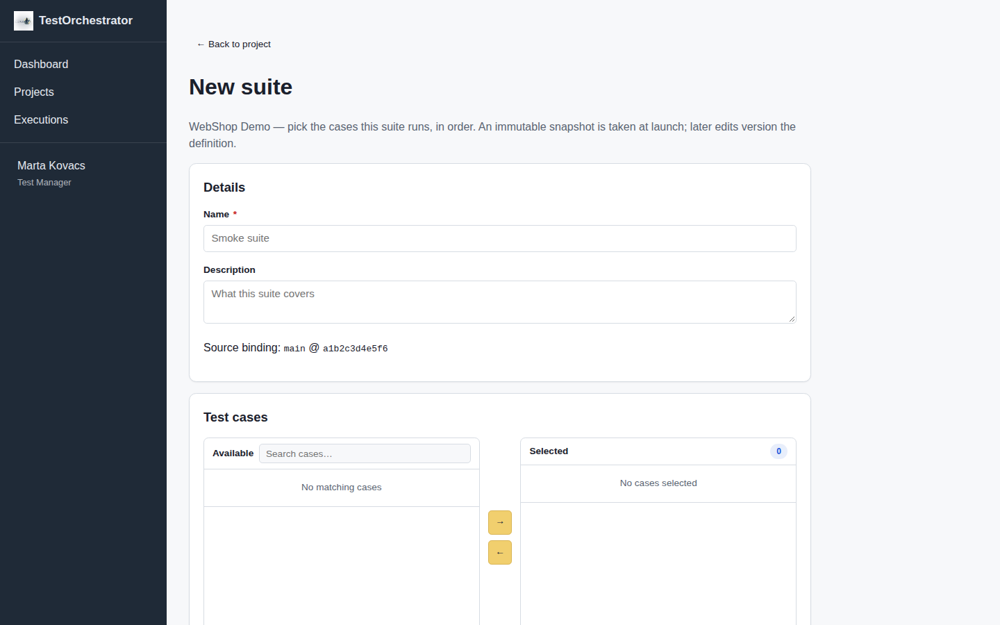

Once saved, the suite page shows the ordered entries, the current
version and content hash, sync status, and the run controls:

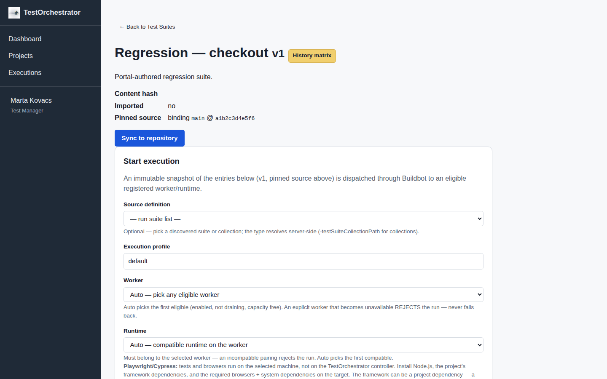

**Edit:**

1. Open the suite → **Edit**. The selector shows the saved order;
   cases that disappeared from the repository remain visible so you
   can remove them deliberately.
2. Saving replaces the entry list wholesale in selector order and
   bumps the suite **version**; the content hash is recomputed.
3. A suite flagged **read-only** (e.g. a definition authored in and
   imported from the repository) refuses edits — change it at the
   source and sync instead.
4. **Sync to repo** writes the suite definition back into the bound
   repository — only for bindings with source authoring enabled
   (§2.2).

**Run:** from the suite page, **Run** opens the execution form —
see §4.2 for every field. Submission re-checks that the pipeline is
actually operational (a registered worker + KRE installation must
exist *now*, not only at setup time); if something is missing the
portal names it and sends you to setup instead of queuing a doomed
run.

### 6.2 Create and manage a release

A release tracks a fixed scope of repository items (suites and
collections) toward a target, with its own run and roll-up status.

**Create:**

1. Open the project → **Releases** → **New release**.
2. Fields:
   - **Name** — required.
   - **Description** — optional.
   - **Start date** / **Target end date** — ISO `YYYY-MM-DD`;
     the end date must be on or after the start date or the portal
     rejects it.
3. The release page opens. It has three parts: the **scope table**,
   the **run history** linked to the release, and **add-to-scope**
   controls.

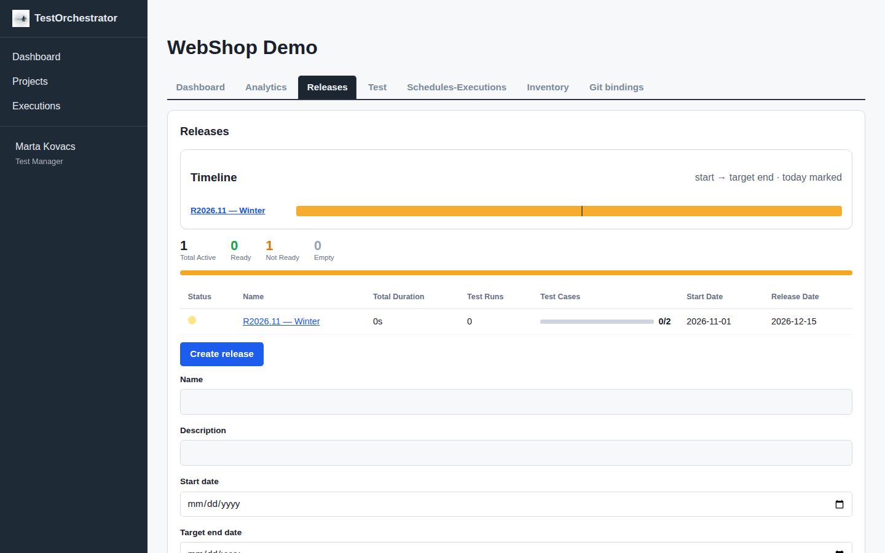

**Build the scope:**

1. In *Add to scope*, pick from the project's discovered **suite**
   and **collection** items and add them — the picker also lists
   discovered test cases for completeness, but adding a case is a
   no-op: scope is suite/collection only. Each row stores the
   item's kind, repository path, and the discovered item it was
   taken from.
2. **Remove** on a scope row drops it.
3. Scope rows show a live state per item:
   - `not yet executed` — no matching run yet;
   - the **outcome of the latest execution** — matched by target
     *and* run configuration (profile, browser, runner, runtime), so
     a pass under one profile does not hide a failure under another;
   - `unavailable — definition removed from repository` — the
     discovered source item was deleted upstream; the scope row keeps
     the last-known path for traceability.

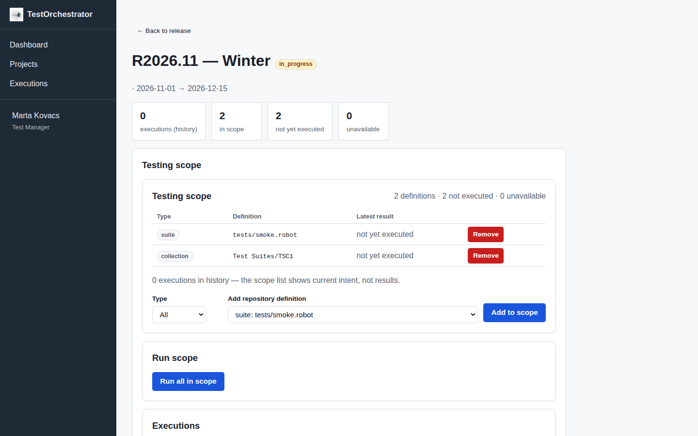

4. **Edit** on the release updates name, description, and dates.

**Sync the release manifest to the repository:**

1. **Sync preview** shows the manifest file the portal would write
   into the release's bound repository (single-binding scope only —
   a scope spanning multiple bindings reports that it cannot sync).
2. **Sync** commits the manifest to the repo and records the written
   path on the release. Any scope or metadata change flags the
   release as sync-dirty until the next sync.

**Run the release:**

1. **Run** queues **one execution per in-scope item** with the run
   form's configuration — execution profile, browser, runner, KRE
   installation (§4.2). Every queued execution is linked to the
   release, which is what the roll-up counts.
2. The portal flashes how many executions were queued; watch them on
   the release page or **Executions**.
3. You can also attach an existing execution retroactively — open the
   execution → **Link release**.

**Roles:** creating, editing, and scope/sync actions need Admin or
Test Manager; running needs any of Admin / Test Manager / Tester.

### 6.3 Create a plan (schedule)

A schedule fires a target automatically — once at a set time or on a
repeating interval. Targets are either a discovered repository item
or a portal suite.

**Create:**

1. Open the project → **Schedules-Executions** → **Create schedule**.
2. Fields:
   - **Schedule name** — required.
   - **Runs** (target) — pick **one** entry via the two-panel
     selector: a discovered repository item (`suite · path` /
     `collection · path`) or a portal suite. Only one target is
     persisted per schedule — to run several, create a portal suite
     or a collection first. Repository items resolve to their
     current repo path at fire time.
   - **Kind** — `Once` (single run) or `Repeating`.
   - **First run (UTC, `YYYY-MM-DD HH:MM`)** — required for `Once`;
     on `Repeating` a blank means "start now".
   - **Every N minutes** — repeat interval, minimum 5 (default 60).
   - **Execution profile** — free-form profile tag (default
     `default`); becomes part of the run's configuration key.
   - **Browser** — one of the supported KRE browser modes
     (default `Chrome (headless)`).
   - **Remote WebDriver URL / driver type** — only for runs steered
     at an external WebDriver grid.
   - **Timeout (seconds)** — per-run cap, default 3600.
   - **Runner** — `Auto` (any suitable) or a pinned worker.
   - **KRE installation** — `Auto` or a pinned runtime connection.
   - **Overlap** — `Allow overlap` or `Skip if previous run active`
     (a firing is skipped while the previous execution of this
     schedule is still running).
3. Submit — the schedule is created **enabled**.

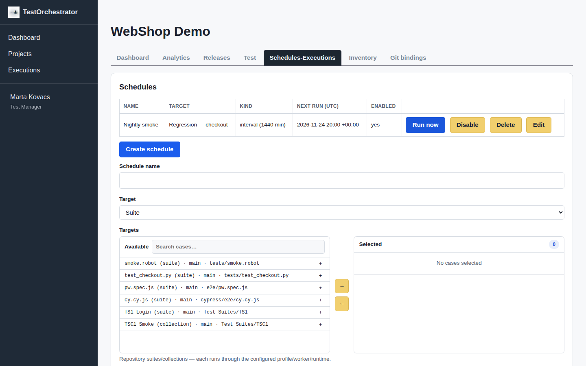

**Operate:**

- **Toggle** pauses/resumes it. Re-enabling a schedule that has no
  next run time schedules it to fire immediately.
- **Edit** changes name, timing, run configuration, and repository
  targets — history is preserved; already-created executions are
  untouched.
- **Run now** fires it once on demand (independent of its clock).
- **Delete** removes the schedule only — executions it created stay.

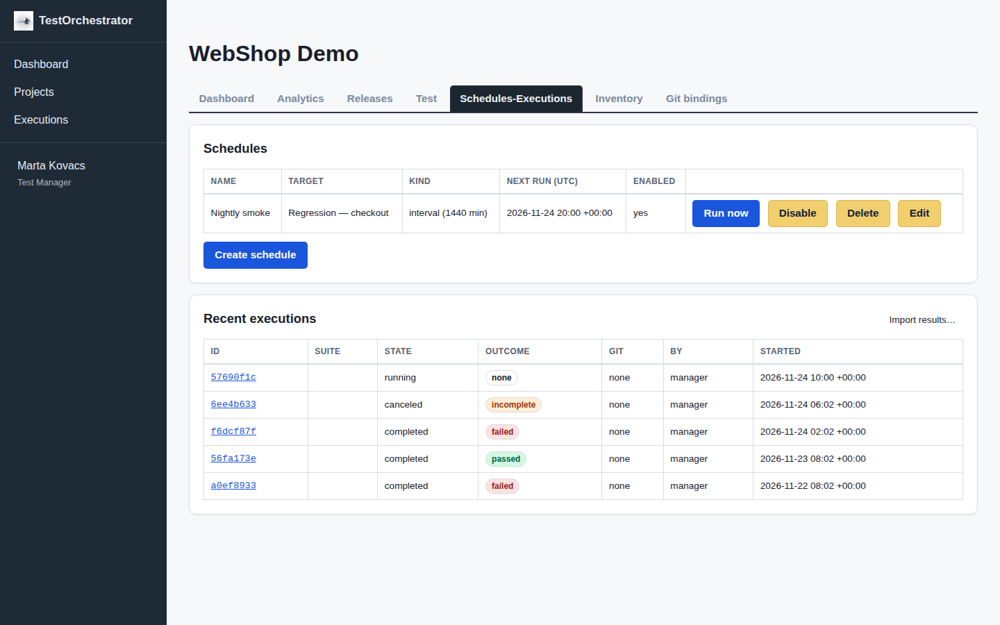

Missed/blocked targets surface the same way as manual runs — check
**Executions** for the fired runs and §4.5 for failure semantics.

---

## 7. Connecting runtimes and running tests

### 7.1 What must exist first

A run needs all of the following — an administrator sets these up
(**Admin → Infrastructure** and **Admin → Workers & runtimes**):

1. **A runner** — an execution-target destination. `remote` runners
   are Buildbot workers or agentless SSH targets.
2. **A registered target** — an enabled execution target in
   coordinator, advertising labels such as `kre=<label>` (plus
   automatic `os`/`arch` labels).
3. **A runtime** — the registered executable *on that target*: a
   KRE installation, a Python interpreter carrying Robot Framework
   or pytest (`robot`/`pytest` kinds), or the `npx` binary used to
   launch Playwright/Cypress (`playwright`/`cypress` kinds). The
   runtime carries its workspace root and the runner binding that
   selects the target.

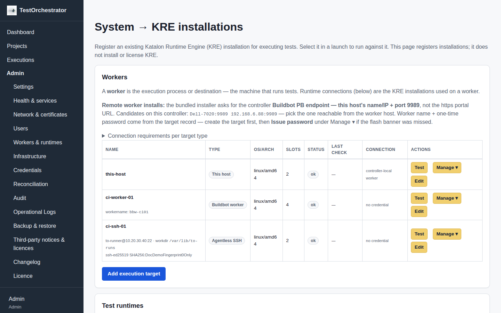

> **KRE licences.** Katalon Runtime Engine requires a valid Katalon
> licence or API key *on the execution host*. TestOrchestrator
> passes invocation through but cannot supply the licence —
> `kre-exec`/`kre-smoke` verify the binary only as far as launch.
> A run that reaches KRE activation without a licence fails with a
> recorded activation error (see §4.5) — that is an environment
> problem, not a portal defect, and it is never silently turned
> green.
>
> In this documentation environment a **fixture** stood in for KRE
> (a script emitting genuine Katalon-format output), so every screen
> showing a live run is labelled accordingly. Licensed execution was
> not validated here.

### 7.2 Starting a suite or collection

From the project's discovered inventory, open a **suite** or
**collection** item and choose **Run**. The form offers the actually
implemented settings:

- **Execution profile** — the Katalon profile name (`default` if
  empty).
- **Runner** — which configured runner to dispatch to.
- **Runtime** — which registered runtime the target invokes. Entries
  tagged `[robot]` are Robot Framework runtimes (2.6.0): they launch
  `python -m robot` with the configured Python interpreter inside the
  staged project **on the selected target**. Robot Framework and the
  project's libraries must already exist in that interpreter — there
  is no browser selector for Robot (browsers are configured by the
  project's libraries). The run form's Robot options select a suite
  file/directory, `--test`/`--suite` names and `--include`/`--exclude`
  tags. Native `output.xml`, `log.html`, `report.html` and the console
  log appear under **Artifacts** alongside the normalized cases.
  Entries tagged `[pytest]` are pytest runtimes (2.6.0): they launch
  `python -m pytest --junitxml Reports/junit.xml` with the configured
  Python interpreter inside the staged project **on the selected
  target** — pytest and the project's dependencies must already exist
  in that interpreter. The run form's pytest options map to `-k`
  (keyword expression) and `-m` (marker expression); there is no
  browser selector (browsers belong to the test project's fixtures).
  Entries tagged `[playwright]` or `[cypress]` are the Node.js browser
  runners (2.6.0): they launch `npx playwright test` /
  `npx cypress run` inside the staged project **on the selected
  target** — the tests and the browser run there, not on the
  controller. Node.js, the project's framework dependencies, and
  the browsers must already be installed on that target (a project
  dependency is enough — no global install or agent is needed).
  If a run rejects with a readiness-style error, ask the
  administrator to run **Check runner readiness** on the
  Infrastructure page — it reports exactly what the target is
  missing (Node.js, the framework, a browser, or reachability of
  the application URL).
- **Browser** — for Playwright: `chromium`, `firefox`, `webkit`
  (a `--project` of the same name, or the framework default when
  empty). For Cypress: `chrome`, `firefox`, `edge`, `electron`,
  `chromium` (`--browser` flag). Unsupported values reject the
  run — they are never silently substituted.
- **Timeout** — seconds before the run is considered timed out.

Confirm to queue the execution. You are taken to the execution detail
page. Playwright/Cypress runs produce the same result view as KRE
runs: JUnit is parsed into per-case rows, and raw JUnit, console
logs, traces, screenshots, and videos appear under **Artifacts**
on the run details — including when assertions fail. A missing or
unreadable report is shown as an environment/collection problem,
never as a green run with zero tests.

### 7.3 Monitoring an execution

The execution page shows lifecycle state, outcome, worker, suite,
timestamps, a results table, artifacts, and provenance.

States you will see: `queued` → `dispatched`/`running` → a terminal
state (`completed`, `failed`, `canceled`). A run you cancel sits in
`cancel_requested` until the coordinator confirms termination. A run
whose outcome the portal cannot determine lands in `unknown` — that
is honest uncertainty, never silently retried; check its error text
and audit trail before deciding to rerun it manually. **Outcome**
(`passed`, `failed`, …) is computed from the returned test results —
it is distinct from the lifecycle state. A run can be `completed`
with outcome `failed` (tests ran and failed) or `failed` with no
outcome (the machinery broke).

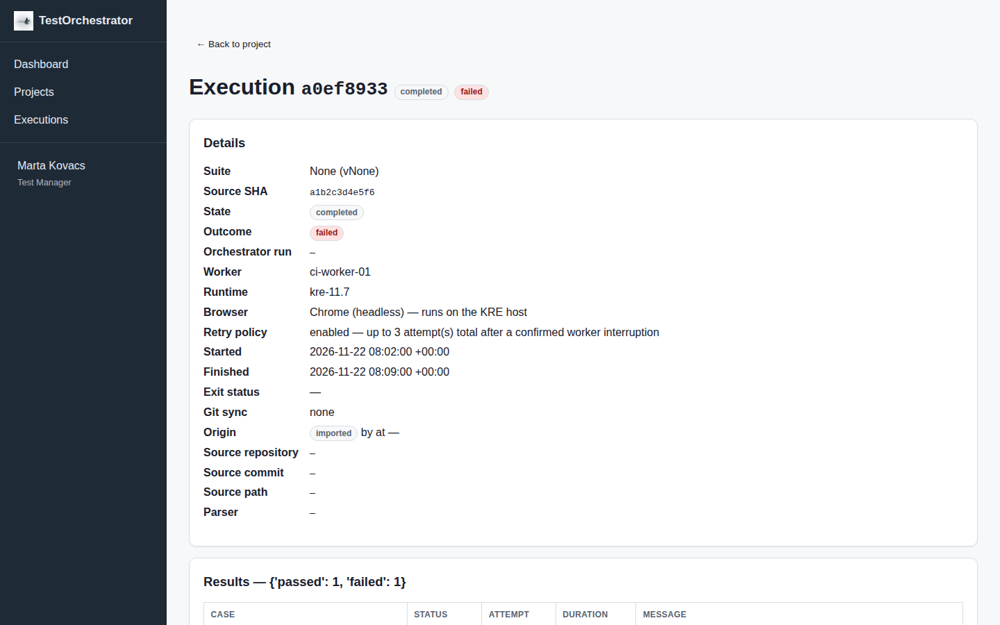

### 7.4 Cancellation, retry, and deletion

- **Cancel** — requests cancellation per selected execution (the bulk
  bar on the Executions page, or per execution). The execution moves
  to `cancel_requested` while the portal asks the coordinator to stop
  the workflow run; once the coordinator confirms the abort, the
  execution settles in terminal `canceled` and both steps appear in
  the audit trail. A cancel request is honored quickly — the brief
  `cancel_requested` window is the stop propagating, not a stuck
  state. If the coordinator itself was unreachable, the run can land
  in `unknown` instead of `canceled` — treat that as "termination
  unconfirmed" and check the audit trail.
- **Retry** — re-queues a finished execution with its recorded run
  configuration, linked as a new attempt.
- **Delete** — marks the execution for deletion. The portal first
  removes the published remote report copy, then the execution
  record, then its owned local evidence directories. Evidence that
  another execution still references is preserved (see
  Admin Manual §9).

### 7.5 Reading outcomes: test failure vs. infrastructure failure

| What you see | What kind of problem it is | What it means, in plain words | Example |
|---|---|---|---|
| `completed` + outcome `failed`, cases listed with `<failure>` messages | **Test failure** | the tests ran and some failed — a real, honest test result | a login test asserting the wrong welcome text |
| `failed`, no cases, run log shows `No Offline License … Activation failed` | **Licence/activation failure** | the test engine started but could not activate its licence — nothing was really tested | a Katalon run on a machine with no licence key |
| `failed`, no cases, dispatch/checkout/workspace errors | **Infrastructure failure** | the job never even reached the tests — the machinery broke first | the worker could not download the repository |
| `incompleted`/partial results, `framework=unknown` artifacts | **Incomplete** | the output was cut short or came from a tool the server does not recognise — treat with care | a power cut mid-run |

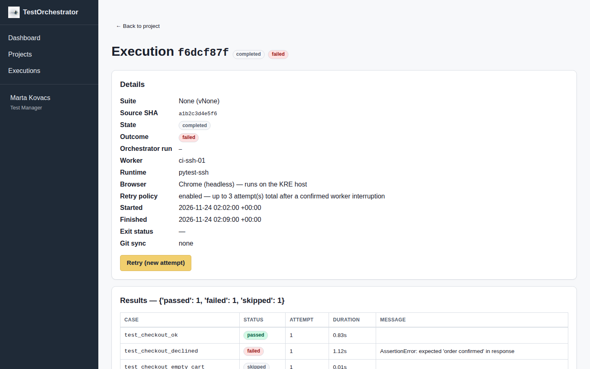

### 7.6 The application-licence notice

TestOrchestrator's own application licence is **informational
only** — it never blocks you. If the licence is missing, expired,
or otherwise not valid, the login page shows the notice:

> This version is not supported

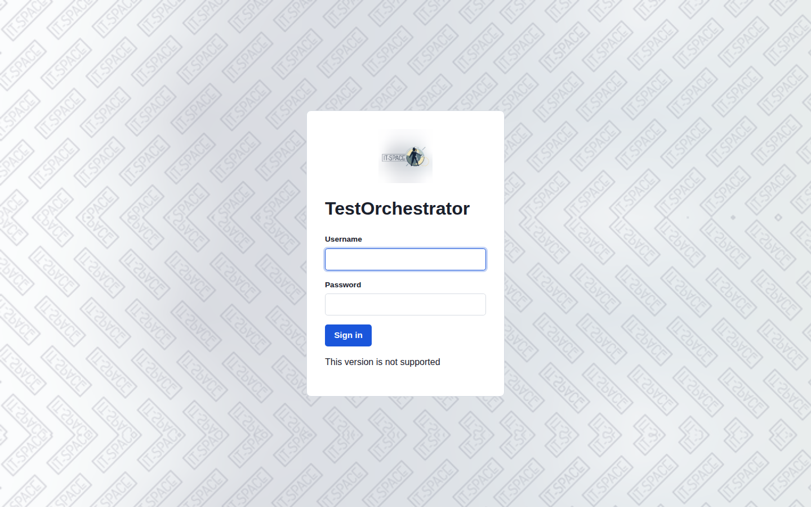

*Login with no valid application licence — the notice is
informational and sign-in works normally.*

That is all it does. You can still sign in normally and every
feature — projects, runs, schedules, imports, reports — works
exactly the same. Nothing is queued, held, or restricted. An
administrator can record a licence at **System → Licence** to clear
the notice, but is not required to.

This is the **application** licence — separate from the KRE licence
that must exist on each execution target (§4.1). An
`Activation failed` result (§4.5) means the target's KRE licence, not
the portal's application licence.

### 7.7 Step by step — Robot, pytest, Playwright, Cypress

This is the everyday "run my tests" walkthrough for the four
non-KRE frameworks. You do not install anything — the
administrator already registered the target and the runtime
(Admin Manual §12.5–12.8). Your job is five clicks and the right
three dropdowns.

**Before you start, one thing must be true:** the test project is
in a repository the project syncs (Git bindings tab) — the run
stages *that* checkout on the target, not anything from your
machine. If your suite does not appear under the project's
**Inventory** tab, ask for a sync first.

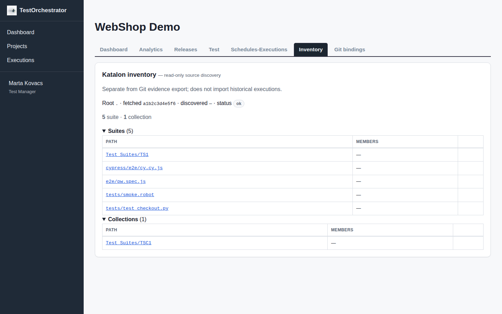

#### Step 1 — open the item

Projects → your project → **Inventory** (or **Test** → suites) →
click the suite or collection you want to run — a Robot `.robot`
file, a `test_*.py` file/package, a Playwright `.spec.*`, a
Cypress `.cy.*` spec, or a collection grouping them. The item page
shows a **Run** form.

#### Step 2 — fill the form

1. **Profile** — Katalon profiles only; leave `default` for the
   four frameworks (they ignore it).
2. **Release** — optional; attach the run to a release for
   history/matrix grouping.
3. **Worker** — which execution target runs the tests. `Auto`
   picks the first compatible; pick a specific target when the
   runtime lives only there (its name is whatever the
   administrator gave it — e.g. `ci-worker-01` for a Buildbot
   worker, `ci-ssh-01` for an SSH target; you cannot tell the
   transport apart from this list and do not need to).
4. **Runtime** — the framework. Entries are tagged:
   `[robot]`, `[pytest]`, `[playwright]`, `[cypress]` — or untagged
   for KRE. Pick the one matching your test file.
5. **Browser** — **the field most often set wrong.**
   - `robot` / `pytest`: there is no portal browser — leave
     *framework default*; the project's own configuration decides.
   - `playwright`: `chromium`, `firefox`, `webkit`, or framework
     default.
   - `cypress`: `chrome`, `firefox`, `edge`, `electron`,
     `chromium`, or framework default.
   - The KRE optgroup (Chrome headless etc.) is for KRE runs —
     choosing it on a framework run is rejected at dispatch as a
     config error. That rejection is correct behaviour: fix the
     field, don't retry.
6. **Framework options** — only the block matching your runtime
   applies: *Robot options* = `--test` name, `--include`/`--exclude`
   tags (comma-separated); *pytest options* = `-k` keyword and `-m`
   marker expressions. Leave empty to run everything in the item.
7. **Parallelism** — *framework default* is the safe choice;
   `parallel N` uses Playwright `--workers`, pytest `-n` (needs
   xdist on the target), Robot Pabot — and is refused if the
   optional dependency was not detected on that target.
8. **Timeout** — seconds before the run is considered timed out.

#### Step 3 — submit and watch

Submit → you land on the execution page; the state moves
`queued` → `running` → a terminal state (§4.3). The tests execute
**on the target**, not on the portal — a slow run is usually the
target, the network, or the suite itself.

#### Step 4 — read the result

`completed` + outcome `failed` means *your tests* failed — open
the results rows; `failed` with no cases means the run never
reached the tests (§4.5): a readiness problem (missing Node,
missing interpreter module, unreachable app) or a bad option —
the run's log says which. Artifacts (JUnit XML, console log,
`output.xml`/`log.html`/`report.html` for Robot, traces/videos for
Playwright, per-spec JUnit for Cypress) are under **Artifacts**.

**If the run never starts or fails at launch**, the fix is almost
always on the target, not in the portal — ask the administrator
for a **Check runner readiness** on that runtime (Admin Manual
§6.6–6.8). The probe reports exactly what is missing.

---

## 8. Historical-result import

Import adopts existing Katalon `Reports/` output into execution
history with provenance. It never rewrites what it imported.

### 8.1 Starting an import

On the project page choose **Imports → New import**. Pick the bound
repository, the **revision** (ref or `HEAD` — it is resolved to an
exact commit before scanning), and the **result directory** to scan
(typically `Reports`).

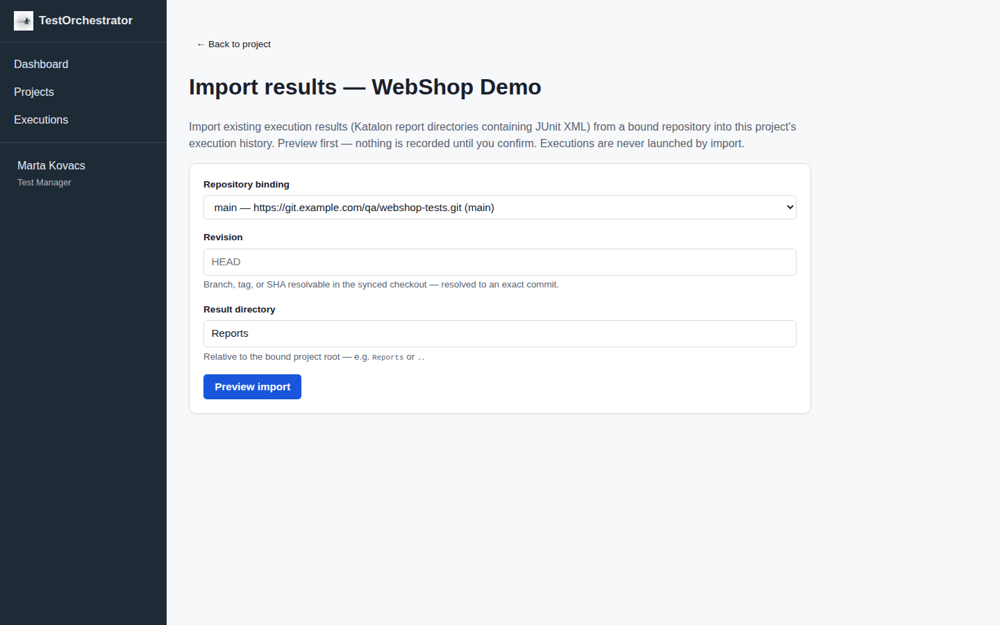

### 8.2 The preview

The preview materializes the chosen revision into a private staging
checkout (your working tree is never touched), detects every result
directory, parses its JUnit output, and **classifies** each candidate
against project history *before* anything is written.

Decisions you will see:

| Decision | Meaning | On confirm |
|---|---|---|
| `new` | No matching run in history | Imported as a new execution |
| `duplicate` | Same run identity already imported (by `execution.uuid`, or by identical content) | Skipped — re-check at confirm time keeps it safe |
| `ambiguous` | Conflicting evidence (e.g. same identity, different content) | Only imported if you explicitly tick it; it is imported as a **new** run — never merged |
| `supplement` | Same run, with data the stored execution lacks (e.g. a collection suite that arrived later) | The missing pieces are merged into the existing execution |

Group behaviour:

- Report directories that share an `execution.uuid` are treated as
  **one collection run** — the preview groups them and confirms them
  as a single execution covering every member suite.
- A suite that appears in a **later** import of the same run becomes a
  `supplement` candidate: its cases, suite key, and files merge into
  the stored execution; existing data is preserved.
- Two runs with **different** `execution.uuid` values stay distinct
  executions — that is how reruns of the same suite are represented.
- JUnit files without a Katalon fingerprint and not matching any known
  producer are imported with `framework=unknown` — the run is kept,
  but flagged as an unidentified producer.

### 8.3 Confirming

Tick the candidates to import and choose **Import selected**.
Duplicates and ambiguous rows are re-checked at confirm time; two
administrators confirming the same candidate cannot create a double
execution (a per-project import lock serializes the recheck).

Confirmation is **not** an atomic batch: each candidate commits
independently. If something interrupts the batch, imported candidates
stay imported and pending/failed ones can be retried — the staging
checkout is retained while retryable candidates remain.

### 8.4 Provenance

Every imported execution records who imported it, when, the source
repository, the resolved commit, the source result path, and the
parser used (e.g. `kre-junit/1`). This is on the execution page and
inside its stored snapshot.

### 8.5 Warnings and missing evidence

Import reports what it could not do: unparseable files, missing
`execution.uuid` (matched by content instead), artifact files
referenced but absent, and cases whose evidence could not be mapped.
**Importing cannot recreate missing evidence** — if a log or
screenshot is not in the result directory, it is not in the imported
execution either; the warnings tell you exactly what is absent.

### 8.6 Retrying a failed candidate

A candidate that failed during confirm (parse error, transient
staging problem) stays on the preview with its failure and can be
re-confirmed — the staging checkout is deliberately kept until no
retryable candidates remain.

---

## 9. Reports and evidence

### 9.1 Execution history

**Executions** lists every run with filters for ID prefix, project,
lifecycle state, outcome, target, schedule, date range, origin
(live/imported), and framework. Fifty per page.

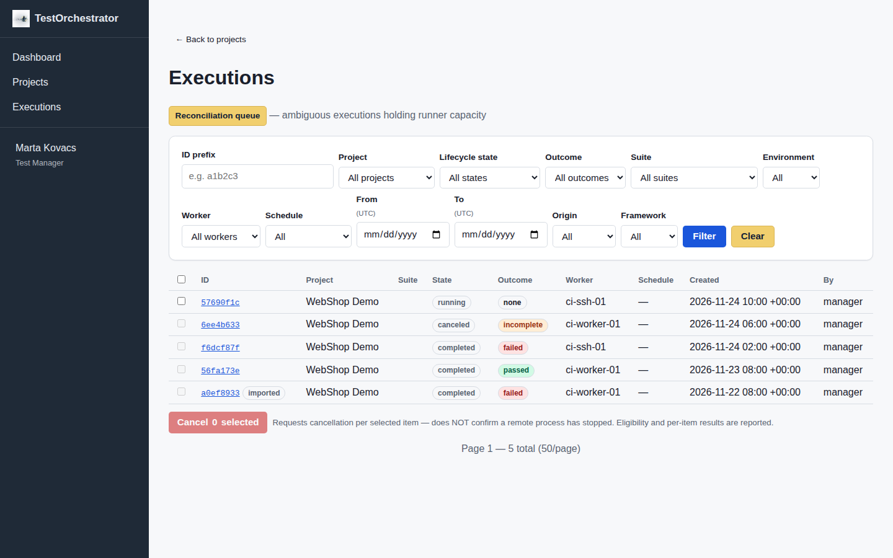

### 9.2 reportingLabs reports

An execution's **Report** view embeds the generated reportingLabs
HTML — overview, per-test status, failures, graphs, and timeline.

Report generation states (`rl_status`):

- `ready` — a generated report exists and is current.
- `missing` — nothing to generate from (no stored results/evidence).
- `failed` — generation attempted and failed; the error is recorded
  and **Regenerate** retries from stored results — it never touches
  the original artifacts.

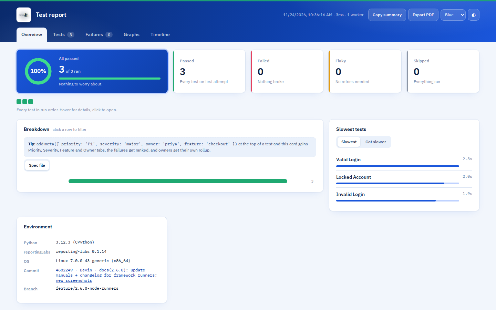

### 9.3 Evidence

The execution page lists retained **artifacts**: JUnit XML, Katalon
`execution.uuid`, execution/console logs, screenshots, HAR files,
native Katalon HTML/CSV reports, and (for live runs) the target run
log. **Download** options provide a report ZIP and an artifacts ZIP.

Evidence lives under managed directories owned by executions (see
Admin Manual §9). Deleting an execution removes only the evidence it
owns; evidence another execution also references is kept.

### 9.4 Troubleshooting missing or incomplete results

- No results table — the run failed before producing JUnit
  (activation or infrastructure failure); read the run log artifact.
- `rl_status=missing` — there were no stored results to report on.
- An imported execution with warnings — open its provenance and
  warnings; the missing files were missing at the source.

---

## 10. Fixture-vs-licensed statement for these screenshots

All screens in this manual were captured on a packaged Linux
installation running the released 2.5.0 codebase. Live-execution
screens used a **fixture** KRE stand-in
emitting genuine Katalon-format output — they demonstrate dispatch,
registration, execution plumbing, result/evidence return, and report
generation, **not licensed KRE execution**. Licensed-KRE execution
requires a valid Katalon licence/API key on the target host and was not
validated in this environment. Imported-execution screens show
**real Katalon 11.7.0 output** produced by a licensed run elsewhere.

---

## 11. Your first run — step by step

This chapter takes you from sign-in to reading your first result.
Every step is one action. After each step you see exactly what should
be on the screen, and what to do when it is not.

You need three things before you start — ask your administrator if you
do not have them:

- The **address** of TestOrchestrator (it looks like
  `https://tests.example.org`).
- A **username and password**.
- A test repository you can read (a git URL).

Words in *italics* are explained in the Glossary (§14) the first time
they appear.

### 11.1 Sign in

**Step 1.** Open your browser. Type the TestOrchestrator address into
the address bar. Press Enter.

You should see the sign-in page: a box with two empty lines,
*Username* and *Password*, and a **Sign in** button.

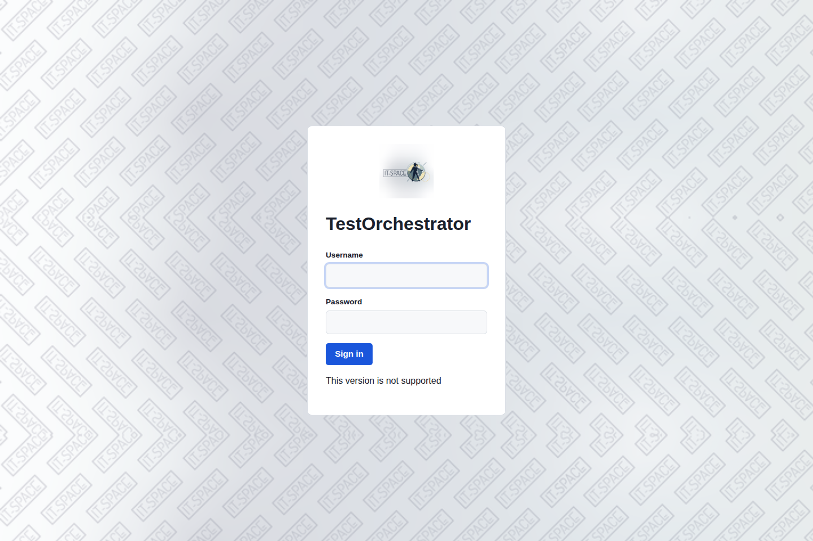

*If you do not see this:* if the browser says the site cannot be
reached, check the address with your administrator. If you see a
warning about the address, you may be using the wrong host name — use
exactly the address you were given, not the server's IP number.

**Step 2.** Click the *Username* line. Type your username. Click the
*Password* line. Type your password. Click **Sign in**.

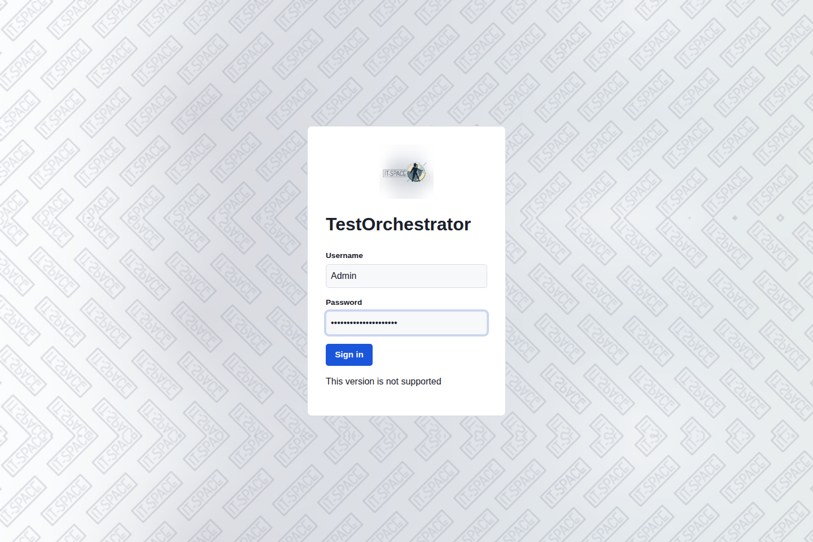

You should see the home page with a menu on the left.

*If you do not see this:* if the page says the sign-in failed, check
for typing mistakes — passwords are case-sensitive, so `Pass1` and
`pass1` are different words. If it still fails, ask your administrator
to reset your password.

### 11.2 Create a project

A *project* is a box that holds everything about one test effort: its
repository, its tests, its runs and its results.

**Step 3.** In the left menu, click **Projects**.

You should see the project list. On a new install it is empty, and the
page says so. That is normal.

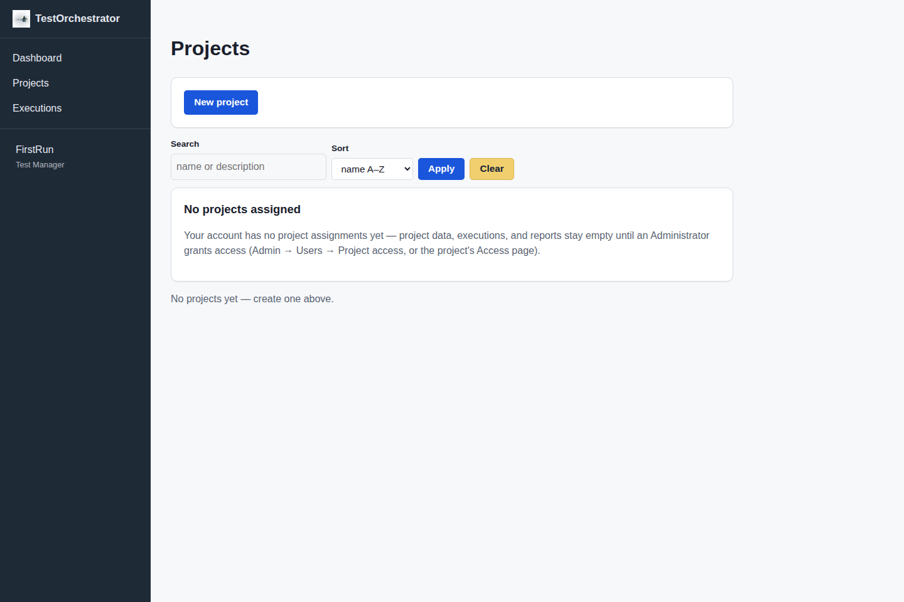

**Step 4.** Click **New project** (top right of the page).

**Step 5.** Click the *Name* line. Type a name, for example
`My first project`. Click **Create**.

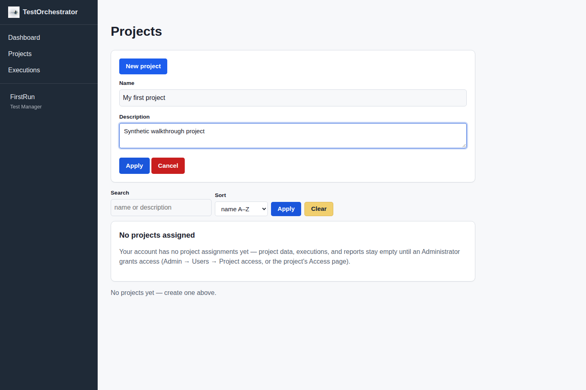

You should see the project page. The name you typed is at the top.

> **Common mistake:** pressing Enter instead of clicking **Create**.
> On some pages Enter sends the form early. If nothing happens, click
> the button with the mouse.

### 11.3 Connect your test repository

A *repository binding* tells TestOrchestrator where your tests live.
It copies (syncs) the repository so it can find your tests.

**Step 6.** On the project page, find the **Repositories** area.
Click **Add binding**.

**Step 7.** Click the *URL* line. Type the git address of your test
repository, for example `https://git.example.org/team/tests.git`.

**Step 8.** Click the *Branch* line. Type the branch name, for
example `main`. Click **Save**.

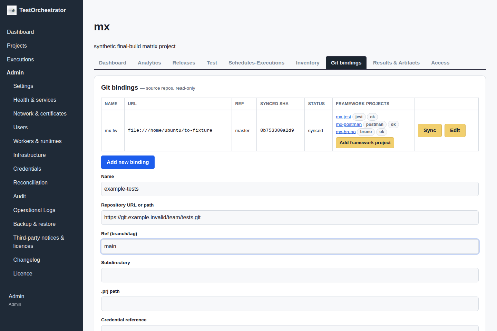

You should see the new binding in the list. Its sync state starts as
*pending* and changes to *synced* when the copy finishes. A small
repository takes a few seconds; a big one can take minutes.

*If you do not see this:* if the state changes to *failed*, click it
to read the message. The most common cause is a typing mistake in the
URL. Fix it and save again.

### 11.4 Add a framework project

A *framework project* tells TestOrchestrator which test framework
your tests use (for example Jest or Postman) and where they sit inside
the repository.

**Step 9.** On the project page, find the **Framework projects**
area. Click **Add framework project**.

**Step 10.** Open the *Framework* dropdown. Click your framework's
name — for this walkthrough we use **Jest**.

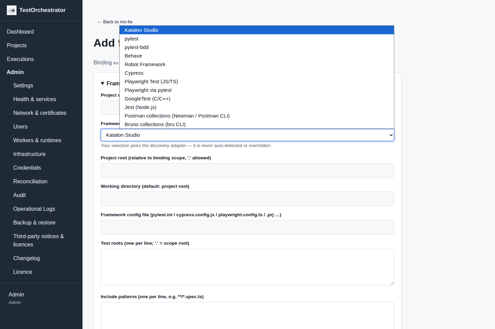

**Step 11.** Click the *Project root* line. Type the folder inside the
repository where the tests live, for example `jest`. If the tests are
at the top level of the repository, leave it empty. Click **Save**.

You should see the framework project in the list with a discovery
status. Wait until the status shows `ok` and the item count is not
zero. *Discovery* means TestOrchestrator read your test files and made
a list of what it found.

*If you do not see this:* zero items almost always means the project
root is wrong. Open the repository in your git host, look at the real
folder names, and compare. Folder names are case-sensitive.

### 11.5 Check the runtime

A *runtime* is the machine that actually runs the tests, with the
tools installed. Your administrator connects runtimes. Before the
first run, look at it once.

**Step 12.** In the left menu, click **Infrastructure**. Click
**Runtimes**.

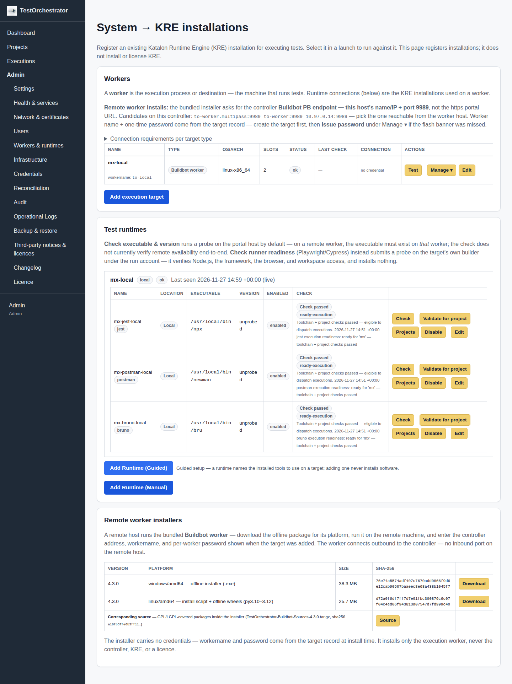

You should see at least one runtime with the state **ready-execution**.
That means: the machine answered its health check (a *probe*), and a
small proof run for your project succeeded.

*If you do not see this:* if the state is **checking**, wait a minute
and reload the page — the probe is still running. If it is **failed**
or **missing-dependency**, show the page to your administrator; the
message on the page says exactly what is missing.

### 11.6 Run one test

**Step 13.** Go back to your project. Click **Run**.

**Step 14.** In the run form: open the framework-project dropdown,
click your framework project. Open the runtime dropdown, click the
ready runtime.

**Step 15.** In the item list, tick exactly one test — pick the
smallest one. Click **Start run**.

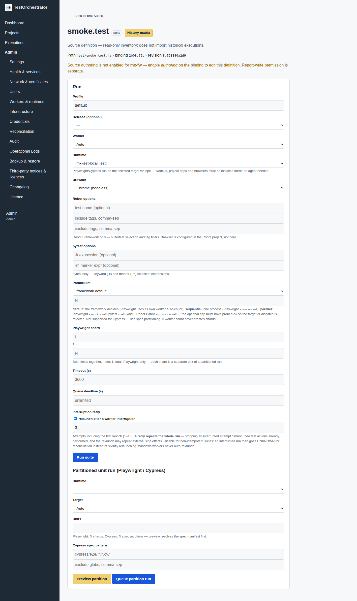

You should see the execution page. The state line starts as *queued*,
then *running*.

### 11.7 Read the result

**Step 16.** Wait for the state to change to *completed*. Reload the
page if it does not update by itself.

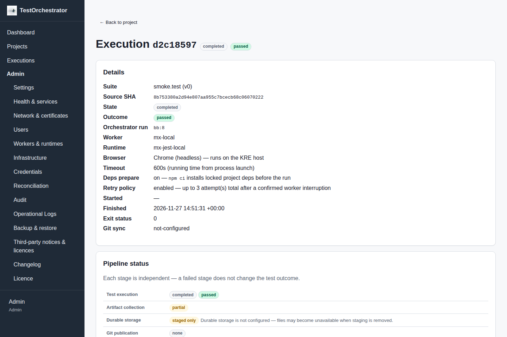

Read the outcome:

- **PASSED** — every test in the run passed. You are done — your
  first run worked.
- **FAILED** — a test failed. This is a test result, not a machine
  problem. Scroll to the results table: the failed line has the test
  name and the error message.
- **INCOMPLETE** — the machine could not finish the run. Read the
  error line on the page, then see §5.6.

**Step 17.** Click **Artifacts**. You should see the report files the
framework wrote — for Jest a `jest.json` and a `manifest.json`, plus
the run logs. Click one to open it.

> **Common mistakes — first run**
>
> - Running before discovery shows items: the run form list is empty.
>   Go back to §11.4 and check the project root.
> - Picking a runtime whose state is not *ready-execution*: the run
>   is refused with a message. That is correct behaviour — wait or fix
>   the runtime first.
> - Reading FAILED as a machine problem: FAILED means the tests ran
>   and a test lost. Only INCOMPLETE is a pipeline problem.

### 11.8 What just happened — in one paragraph

TestOrchestrator copied your repository, found your tests in the
folder you named, sent the one test you ticked to the runtime machine,
ran it there with the real framework, collected the report files, and
showed you the outcome. Every next run works the same way — only the
selection gets bigger.

## 11A. Framework walkthrough — Jest

A complete Jest run from a fresh project to reading results, with the
exact values to type. The examples use a repository whose tests live in
a folder called `jest` — the most common layout, and the one that
surprises people.

You need: a finished first run (§11) or an existing project, and a Jest
runtime in the **ready-execution** state (§11.5).

### What is different about Jest

Jest is a *node* framework. The runtime machine runs your tests with a
tool called `npx`. Your repository must contain a file called
`package-lock.json` in the Jest project folder — it is the exact list
of tool versions your project uses. Without it TestOrchestrator
**refuses to run**. This is on purpose: it stops the run machine from
downloading unknown code. The refusal message names the missing file
and the folder it looked in.

### Step by step

**Step 1.** Open your project. In **Repositories**, check the binding
state is *synced*. Write down the long identifier next to it — the
*commit sha*. Every result you read later is tied to that exact
version.

**Step 2.** In **Framework projects**, click **Add framework project**.
Type these values:

| Field | Value to type |
|---|---|
| Framework | `jest` |
| Name | `jest-tests` |
| Project root | `jest` |

Click **Save**.

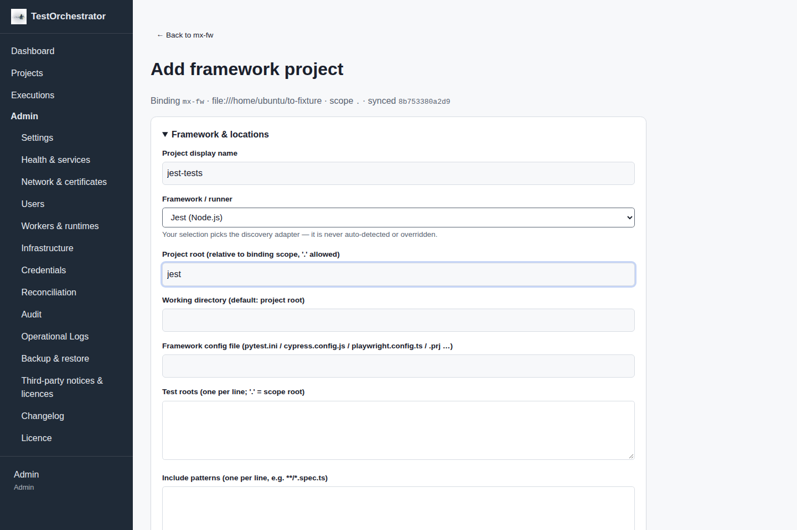

**Step 3.** Wait for the discovery status to show `ok`. Click the
framework project. You should see the discovered items — your
`*.test.js` files, one line each.

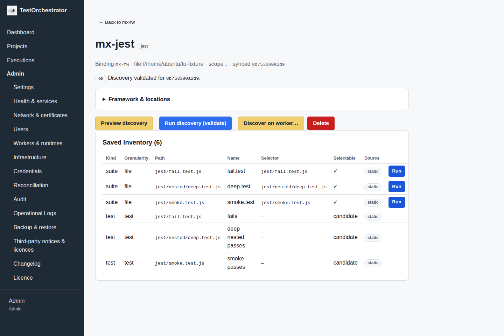

*If you see zero items:* open your repository in the browser and check
that inside the `jest` folder there really are files ending in
`.test.js`. If your files end differently, discovery will not find
them — rename or adjust.

**Step 4.** Click **Run**. Fill in the form:

| Field | Value to pick |
|---|---|
| Framework project | `jest-tests` |
| Runtime | your Jest runtime |
| Items | tick one `smoke` or small test file |

Click **Start run**.

**Step 5.** On the execution page, wait for *completed*. Expected
result for a passing test: outcome **PASSED**, one line in the results
table per test file, artifacts `jest.json` and `manifest.json` under
**Artifacts**.

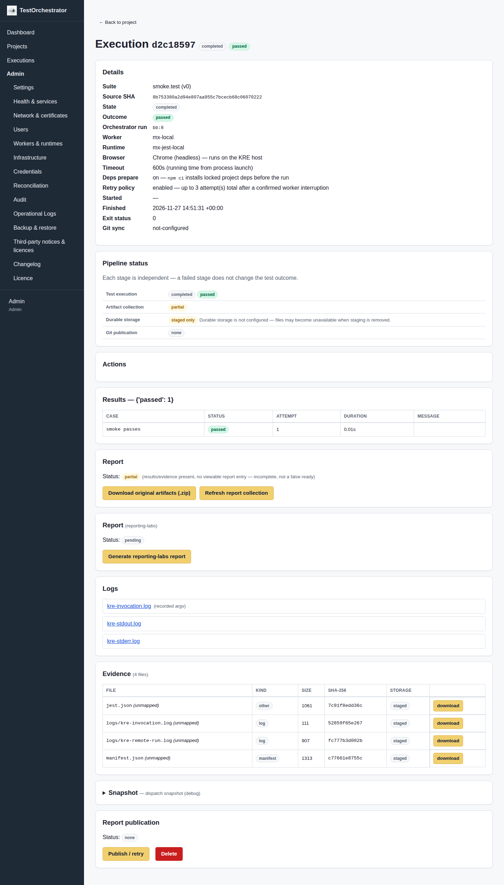

### Reading a Jest failure

When a test fails, the outcome is **FAILED** and the results table
shows the test name with Jest's own message — for example
`expect(received).toBe(expected)`. Open `jest.json` in the artifacts
for the full detail. FAILED is a test result: fix the test or the
application, not TestOrchestrator.

### When the run is INCOMPLETE

INCOMPLETE means the machine did not finish. The error line names the
cause. The three usual ones for Jest:

| Error line says | What it means | What to do |
|---|---|---|
| lockfile missing / required | No `package-lock.json` in the project folder | Add it in the repository (`npm install` writes it), commit, re-sync |
| `no result data` | Jest never wrote its report — usually the project root is wrong or the tools are missing | Check the project root; check the runtime state |
| `bad option: --no-install` in the step log | The runtime executable is `node`, not `npx` | Administrator fixes the runtime executable path — see Admin Manual §10 |

> **Common mistakes — Jest**
>
> - Project root typed with a leading slash (`/jest`) — roots are
>   relative to the repository, never absolute.
> - `package-lock.json` at the repository top while tests are in a
>   subfolder — the lockfile must sit in the same folder as the
>   project's `package.json`.
> - Re-running after editing the repository without re-syncing — runs
>   use the synced copy, not your latest push.

## 11B. Framework walkthrough — Postman

Postman tests live in *collections* — files ending in `.json` exported
from the Postman application. The runtime runs them with a tool called
*newman*.

You need: a project with a synced repository that contains at least one
exported Postman collection, and a Postman runtime in the
**ready-execution** state.

### Step by step

**Step 1.** In **Framework projects**, click **Add framework project**.
Type these values:

| Field | Value to type |
|---|---|
| Framework | `postman` |
| Name | `api-collections` |
| Project root | `postman` (the folder with your collections — empty if they are at the top) |

Click **Save**.

**Step 2.** Wait for discovery status `ok`. Click the framework
project. You should see one line per collection file.

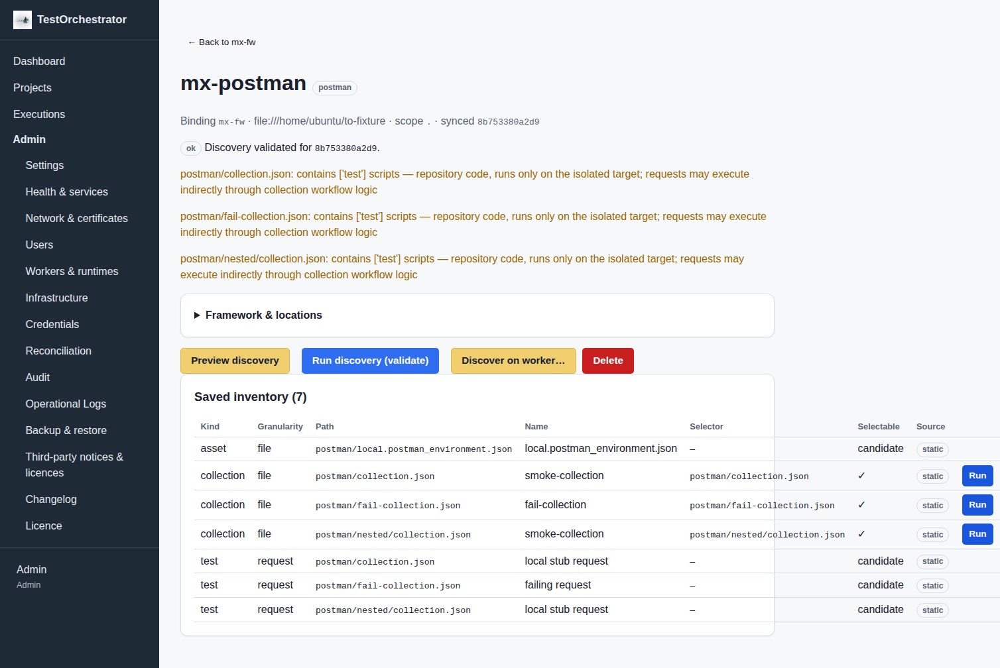

**Step 3.** Click **Run**. Pick the framework project and the Postman
runtime, tick one collection, click **Start run**.

**Step 4.** Wait for *completed*. Expected for a passing collection:
outcome **PASSED**; artifacts include `postman.json` (newman's own
report), `junit/newman.xml` and `manifest.json`.

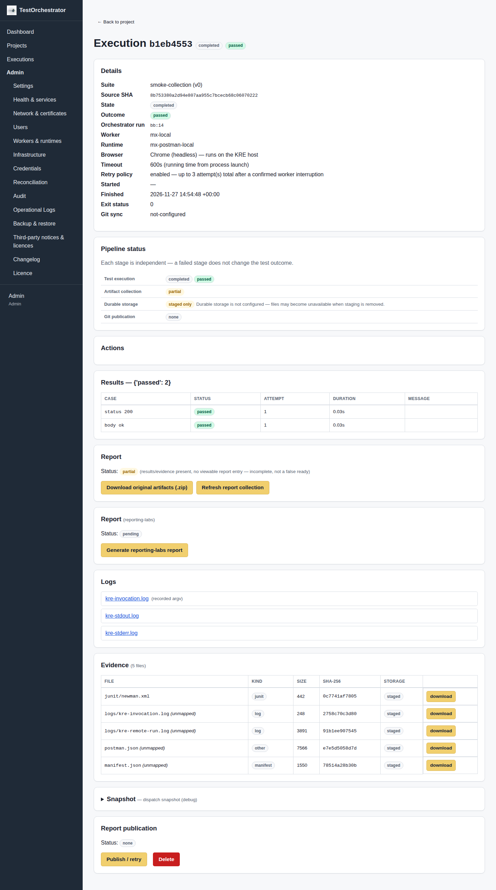

### Reading results

Each line in the results table is one request in the collection, with
its test assertions. A FAILED outcome means a request or assertion
failed — the message column carries newman's own text, for example
`expected 200 to equal 500`. Open `postman.json` in the artifacts for
the full request and response detail.

> **Common mistakes — Postman**
>
> - Exporting the wrong file: discovery finds *collections*, not
>   Postman *environments*. Environment files are inputs, not tests.
> - Collections that call a real server: the server must be reachable
>   from the runtime machine, not from your own computer. A request
>   that works on your desk can fail on the runtime with a connection
>   error — that is the network, not a bug in the run.

## 11C. Framework walkthrough — Bruno

Bruno tests live in `.bru` files — one file per request. The runtime
runs them with the `bru` command-line tool.

You need: a project with a synced repository containing `.bru` files,
and a Bruno runtime in the **ready-execution** state.

### Step by step

**Step 1.** In **Framework projects**, click **Add framework project**.
Type these values:

| Field | Value to type |
|---|---|
| Framework | `bruno` |
| Name | `api-bruno` |
| Project root | `bruno` (the folder with your `.bru` files — empty if at the top) |

Click **Save**.

**Step 2.** Wait for discovery status `ok`. Open the framework project:
one line per `.bru` file.

**Step 3.** Click **Run**. Pick the framework project and runtime,
tick one file, click **Start run**.

**Step 4.** Wait for *completed*. Expected for a passing file: outcome
**PASSED**; artifacts include `bruno.json`, `bruno.html` (a report you
can open in a browser), `junit/bruno.xml` and `manifest.json`.

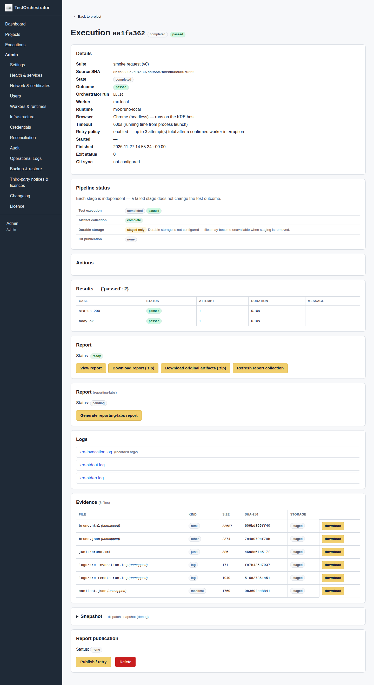

> **Common mistakes — Bruno**
>
> - `.bru` files that depend on each other (shared login tokens, for
>   example) must run together — tick all of them in one run, in the
>   order they need.
> - A FAILED line reading `expected 200 to equal …` is Bruno's own
>   assertion text — open `bruno.html` for the full request/response.

## 11D. Framework walkthrough — Pytest

Pytest tests are Python files, usually named `test_*.py`. The runtime
runs them with the Python interpreter configured on the runtime —
the same Python that has your test libraries installed.

You need: a project with a synced repository containing pytest tests,
and a pytest runtime in the **ready-execution** state.

### Step by step

**Step 1.** In **Framework projects**, click **Add framework project**.
Type these values:

| Field | Value to type |
|---|---|
| Framework | `pytest` |
| Name | `unit-tests` |
| Project root | `tests` (the folder with your test files — empty if at the top) |

Click **Save**.

**Step 2.** Wait for discovery status `ok`. Open the framework project:
one line per test file, with the test functions inside.

**Step 3.** Click **Run**. Pick the framework project and runtime,
tick one file, click **Start run**.

**Step 4.** Wait for *completed*. Expected for passing tests: outcome
**PASSED**; artifacts include the xunit report and `manifest.json`.

### Reading results

Each test function is one line in the results table. FAILED lines carry
pytest's assertion text. INCOMPLETE with a message about a missing
library means the runtime Python does not have a package your tests
import — the administrator installs it on the runtime machine, in the
same Python the runtime uses.

> **Common mistakes — Pytest**
>
> - Tests import a library that is only on your own computer: the run
>   machine needs it too. The readiness probe lists missing libraries
>   when the administrator configures required libraries on the
>   framework project.
> - Test files not named `test_*.py` or `*_test.py`: pytest itself
>   would not collect them either.

## 11E. Framework walkthrough — Robot Framework

Robot tests live in `.robot` files. The runtime runs them with the
`robot` command through the configured Python.

You need: a project with a synced repository containing `.robot`
files, and a Robot runtime in the **ready-execution** state.

### Step by step

**Step 1.** In **Framework projects**, click **Add framework project**.
Type these values:

| Field | Value to type |
|---|---|
| Framework | `robot` |
| Name | `acceptance-tests` |
| Project root | `robot` (the folder with your `.robot` files) |

Click **Save**.

**Step 2.** Wait for discovery status `ok`. Open the framework project:
one line per `.robot` file, with the test cases inside.

**Step 3.** Click **Run**. Pick the framework project and runtime,
tick one file or one test case, click **Start run**.

**Step 4.** Wait for *completed*. Expected for passing tests: outcome
**PASSED**; artifacts include Robot's own `output.xml`, `log.html` and
`report.html` — open `log.html` in a browser for the full detail.

> **Common mistakes — Robot**
>
> - Robot Framework not installed in the runtime Python: the probe
>   reports it — the administrator installs it on the runtime machine.
> - Browser tests (SeleniumLibrary, Browser library) need the browser
>   and its driver on the runtime machine, not on your computer.

## 11F. Framework walkthrough — Behave

Behave tests live in `.feature` files — plain-language scenarios. The
runtime runs them with the `behave` command.

**Step 1.** Add a framework project: Framework `behave`, Name
`bdd-tests`, Project root `features` (the folder with your `.feature`
files). Click **Save**.

**Step 2.** Wait for discovery status `ok` — one line per feature file,
scenarios inside.

**Step 3.** Click **Run**, pick project and runtime, tick one feature,
click **Start run**.

**Step 4.** Wait for *completed*. PASSED means every scenario passed.
FAILED lines carry the scenario name and the failing step. Behave also
needs its *step implementation* Python files next to the features —
missing steps fail the run the same way they fail on your computer.

## 11G. Katalon — static discovery only

Katalon Studio projects are *discovered* — TestOrchestrator reads the
project files and lists the test cases — but running them needs a
licensed Katalon Runtime Engine on the target machine. Discovery works
without any licence, so you can inventory and plan around Katalon
content. Execution requires the licensed runtime; ask your
administrator.

## 11H. Worked examples — plans, suites, schedules, artifacts

Every example below uses the same sample project: repository
`https://git.example.invalid/team/tests.git`, branch `main`, with a
Jest framework project in the folder `jest`. Type the values as written
the first time; change them when you know what they do.

### Example 1 — a test plan that runs every night

A *test plan* is a saved recipe: which tests, on which runtime, with
which settings. A *schedule* runs the plan by the clock.

**Step 1.** Open your project. Click **Test plans** → **New plan**.

**Step 2.** Type these values:

| Field | Value |
|---|---|
| Name | `nightly-jest` |
| Framework project | `jest-tests` |
| Runtime | your ready runtime |
| Items | tick every file |

Click **Save**. The plan appears in the list. From now on you never
re-pick the selections — the plan remembers them.

**Step 3.** On the plan, click **Add schedule**. Type these values:

| Field | Value |
|---|---|
| When | `every day` |
| Time | `02:30` |
| Timezone | your own timezone |

Click **Save**. Expected: the schedule line shows the next run time
in the future. Tomorrow morning there is a new execution in the
history — you did not click anything.

> **Common mistake:** picking the wrong timezone — the schedule fires
> while people are still working. The schedule shows the next fire
> time converted into your timezone; read it once after saving.

### Example 2 — a suite as a fixed snapshot

A *suite* is a frozen list of test items — a snapshot you can run
again and again, even when the repository changes.

**Step 1.** In the project, open **Suites** → **New suite**.

**Step 2.** Type the name `release-candidates`. In the item picker,
tick the items that must pass before a release. Click **Save**.

**Step 3.** Run the suite: **Run** → pick the suite, pick the runtime,
**Start run**.

Expected: the execution uses exactly the frozen item versions, even
if newer commits changed those files. This is how you prove a release
candidate did not regress — the same bytes every time.

### Example 3 — reading artifacts after a run

**Step 1.** Open **Executions**. Click any finished run.

**Step 2.** Click **Artifacts**. Expected files for a Jest run:

| File | What it is |
|---|---|
| `jest.json` | The framework's own result data |
| `junit/*.xml` | The machine-readable report TestOrchestrator read |
| `manifest.json` | The sealed list of everything the run produced, with hashes |
| `logs/` | The run's own log files |

**Step 3.** Click `jest.json`. Expected: the browser shows the file.
The `sha256` in `manifest.json` proves the file you read is exactly
the file the run machine wrote — nobody changed it afterwards.

### Example 4 — reading history

**Step 1.** Open **Executions**. This is the run history — every run
your project ever did, newest first.

**Step 2.** Use the filters: pick outcome **failed**. Expected: only
failed runs remain. Click one and read its results table — the failed
lines and their messages are kept forever, with the exact repository
version (`sha`) the run used.

**Step 3.** Compare two runs of the same test: when the same test
passes in one and fails in the other, look at the sha lines first —
different repository versions are the most common explanation.

## 12. Troubleshooting

| Symptom | Most likely cause | What to do |
|---|---|---|
| Discovery finds zero items | wrong project root | point the root at the folder the tests are actually in, rediscover |
| Every API request fails in milliseconds | `{{variables}}` unresolved — no environment configured | set the environment file (Postman) or environment name (Bruno) — §5.4 |
| "You can run only at the root of a collection" (Bruno) | project root above/below the collection root | point the project root exactly at the folder containing `bruno.json` |
| Runtime missing from the run form | not execution-ready for this framework | check the runtime page — first run in the project stamps readiness evidence |
| "deps_prepare requires a lockfile" | no `package-lock.json` committed | commit the lockfile or vendor `node_modules` |
| "collect is not supported for this framework" | native collect requested for Postman/Bruno/Katalon | use static discovery — it is authoritative for these frameworks |
| Execution INCOMPLETE but tests passed | artifact collection failed | report to your administrator — this is a pipeline defect, not a test result |
| Item greyed out in selection | granularity limit of the framework | §4.4 — select the file or folder instead |
| Stale badges after upstream renames | inventory predates the rename | rediscover — stale entries never drop silently |

## 13. Frequently asked questions

**Does discovery run my tests?** No. Static discovery parses files —
it never executes repository code, installs nothing, sends no
requests. Native collection runs the framework's own listing command
on an isolated runner, only when an admin explicitly starts it.

**Why can't I select a single Postman request?** Neither engine
(Newman nor postman-cli) can run one request — the product never
offers a selection the runner cannot honour. Select the folder or
collection instead.

**Why did my jest run install packages?** Jest needs its dependencies
to even list tests. The install is controlled — lockfile required,
audited, role-gated; see §4.5 and ask your administrator if your
repository should vendor `node_modules` instead.

**What happens if two people run the same tests at once?** Runs are
independent — each gets its own execution record, its own checkout of
its own recorded revision.

**Can a run follow a moving branch?** No — every run records and
checks out an immutable revision. History stays meaningful.

**Where did my artifacts go?** Open the execution — artifacts are
attached to it. Missing artifacts make the execution INCOMPLETE; that
is deliberate, evidence you cannot download is not evidence.

## 14. Glossary

**Artifact** — a file a run produces: reports, logs, screenshots.
Collected automatically; missing artifacts mean INCOMPLETE.
**Binding** — the connection between a project and a git repository.
**Candidate** — an inventory item visible but not yet individually
selectable (see granularity).
**Collection (framework)** — a Postman or Bruno API test collection.
**Discovery** — how TestOrchestrator learns which tests exist; static
(parse-only) or native (framework tool on a runner).
**Execution** — one run of tests, with its own immutable revision,
states, outcome and artifacts.
**Framework** — the test tool your tests are written for.
**Framework project** — project + framework + place in the repository.
**Granularity** — how finely a framework can select: whole project,
folder, file, or individual test.
**Inventory** — the discovered list of tests for a framework project.
**INCOMPLETE** — pipeline failure outcome; never a test result.
**Item** — one entry in the inventory.
**Native collection** — discovery by running the framework tool.
**Plan** — an ordered set of suites/items run together.
**Probe** — the readiness check of a runtime's toolchain.
**Provenance** — how an inventory item was discovered (static/native).
**Runtime** — a registered execution machine.
**Schedule** — a time- or event-triggered run definition.
**Stale** — an inventory entry that no longer matches the repository.
**Static discovery** — parse-only discovery; never executes anything.
**Suite** — a named, versioned set of tests defined in the app.
**Vendored** — committed into the repository itself (node_modules).

---

## Appendix A. Field reference

Every input field in the application, alphabetically by field name.
Each entry gives the label you see on screen, what the field is, its
allowed values and its default. Worked examples and common mistakes
are in the chapter covering the function.
> Forms marked `*Form` in the system/admin blueprints are covered
> in the Administrator Manual chapters; they are listed here too so this
> reference is complete in one place.

### `allowed_projects`

- **Allowed projects** (selectmultiple)   *(in form `RunnerForm`)*

### `authoring_writable`

- **Source authoring (edit native definitions)** (boolean) ; default `True`   *(in form `BindingForm`)*

### `backup_file`

- **Backup file (.tobackup)** (file)   *(in form `RestoreStageForm`)*

### `binding_id`

- **Source binding** (string)   *(in form `SuiteForm`)*

### `browser_type`

- **Browser** (select) — values loaded dynamically ; default `Chrome (headless)`   *(in form `ScheduleForm`)*

### `bruno_collection`

- **Collection folder** (string)   *(in form `ScheduleForm`)*

### `bruno_environment`

- **Environment** (string)   *(in form `ScheduleForm`)*

### `bruno_tags`

- **Tags** (string)   *(in form `ScheduleForm`)*

### `candidate`

- **Detected candidates** (radio)   *(in form `AddressForm`)*

### `case_refs`

- **Test cases** (selectmultiple)   *(in form `SuiteForm`)*

### `certificate`

- **Certificate / full chain (PEM)** (file)   *(in form `ImportCertForm`)*

### `concurrency`

- **Concurrency** (integer) ; default `1`   *(in form `RuntimeForm`)*

### `config_file`

- **Framework config file (pytest.ini / cypress.config.js / playwright.config.ts / .prj …)** (string)   *(in form `FrameworkProjectForm`)*

### `confirm`

- **Confirm passphrase** (password)   *(in form `BackupCreateForm`)*

### `confirm_password`

- **Confirm new password** (password)   *(in form `ChangePasswordForm`)*

### `connection_mode`

- **Connection mode** (radio) — allowed values: `local`, `remote` ; default `local`   *(in form `RunnerForm`)*

### `credential`

- **Your password / fresh-install setup token** (password)   *(in form `RestoreStageForm`)*
- **Your password / fresh-install setup token** (password)   *(in form `RestoreApplyForm`)*

### `credential_file`

- **Worker-local credential file (remote dispatch)** (string) . Absolute path on the WORKER to a protected credential file (0700 dir / 0600 file). The spec carries this path only — the worker's resolver reads the value at exec time.   *(in form `RuntimeForm`)*

### `credential_ref`

- **Credential reference** (string)   *(in form `BindingForm`)*
- **Credential reference** (string)   *(in form `RuntimeForm`)*

### `current_password`

- **Current password** (password)   *(in form `ChangePasswordForm`)*

### `deps_prepare`

- **Dependency prepare (npm ci)** (select) — allowed values: ``, `false`   *(in form `ScheduleForm`)*

### `description`

- **Description** (textarea)   *(in form `ProjectForm`)*
- **Description** (textarea)   *(in form `SuiteForm`)*
- **Description** (textarea)   *(in form `ScheduleForm`)*
- **Description** (string)   *(in form `SecretForm`)*
- **Description** (textarea)   *(in form `RunnerForm`)*
- **Description** (textarea)   *(in form `RuntimeForm`)*

### `display_name`

- **Display name** (string)   *(in form `UserForm`)*

### `exclude`

- **Exclude patterns (one per line)** (textarea)   *(in form `FrameworkProjectForm`)*

### `executable_path`

- **KRE path on the selected worker** (string)   *(in form `RuntimeForm`)*

### `execution_profile`

- **Execution profile** (string) ; default `default`   *(in form `ScheduleForm`)*

### `external_enabled`

- **Enable external/LAN access** (boolean)   *(in form `AddressForm`)*

### `external_host`

- **External/LAN address** (string) . IP address or DNS hostname (no scheme, path, or port). A private LAN IP is fine — it does not make the site Internet-accessible; DNS must resolve and any NAT/firewall forwarding is configured separately.   *(in form `AddressForm`)*

### `feature_roots`

- **Feature-file roots — BDD only (one per line)** (textarea)   *(in form `FrameworkProjectForm`)*

### `framework`

- **What to schedule** (select)   *(in form `ScheduleForm`)*
- **Framework / runner** (select)   *(in form `FrameworkProjectForm`)*

### `git_ssh_key_path`

- **Worker-side SSH key path (for ssh:// bindings)** (string) . Path on the worker's filesystem to its deploy key — the key material never enters the portal.   *(in form `RuntimeForm`)*

### `http_mode`

- **HTTP listener mode** (radio) — allowed values: `redirect`, `disabled`, `development-insecure` ; default `redirect`   *(in form `PortsForm`)*

### `http_port`

- **Public HTTP port (redirect-only)** (integer)   *(in form `PortsForm`)*

### `https_port`

- **Public HTTPS port** (integer)   *(in form `PortsForm`)*

### `include`

- **Include patterns (one per line, e.g. **/*.spec.ts)** (textarea)   *(in form `FrameworkProjectForm`)*

### `intermediates`

- **Intermediate certificates (PEM, optional)** (file)   *(in form `ImportCertForm`)*

### `internal_app_port`

- **Internal app port (Waitress, loopback)** (integer)   *(in form `PortsForm`)*

### `interval_minutes`

- **Every N minutes** (integer) ; default `60`   *(in form `ScheduleForm`)*

### `jest_test_name`

- **Test name pattern** (string)   *(in form `ScheduleForm`)*

### `jest_test_path`

- **Test path pattern** (string)   *(in form `ScheduleForm`)*

### `kind`

- **Kind** (select) — allowed values: `once`, `interval`   *(in form `ScheduleForm`)*
- **Kind** (radio) — allowed values: `git`, `runtime`, `license` ; default `git`   *(in form `SecretForm`)*

### `licence_code`

- **Licence code** (string)   *(in form `LicenceActivationForm`)*

### `max_slots`

- **Max concurrent slots** (integer) ; default `1`   *(in form `RunnerForm`)*

### `misfire_policy`

- **Missed fire** (select) — allowed values: `late`, `skip` ; default `late`   *(in form `ScheduleForm`)*

### `mode`

- **Restore mode** (radio) — allowed values: `fresh`, `replace`   *(in form `RestoreApplyForm`)*

### `name`

- **Name** (string)   *(in form `ProjectForm`)*
- **Name** (string)   *(in form `BindingForm`)*
- **Suite name** (string)   *(in form `SuiteForm`)*
- **Schedule name** (string)   *(in form `ScheduleForm`)*
- **Project display name** (string)   *(in form `FrameworkProjectForm`)*
- **Reference name** (string)   *(in form `SecretForm`)*
- **Name** (string)   *(in form `RunnerForm`)*
- **Connection name** (string)   *(in form `RuntimeForm`)*

### `new_password`

- **New password** (password)   *(in form `ChangePasswordForm`)*

### `os_arch`

- **OS / architecture** (string)   *(in form `RunnerForm`)*

### `overlap_policy`

- **Overlap** (select) — allowed values: `allow`, `skip` ; default `allow`   *(in form `ScheduleForm`)*

### `passphrase`

- **Backup passphrase** (password) . Min 12 characters — encrypts the archive; unrecoverable if lost.   *(in form `BackupCreateForm`)*
- **Backup passphrase** (password)   *(in form `RestoreStageForm`)*
- **Backup passphrase** (password)   *(in form `RestoreApplyForm`)*

### `password`

- **Password** (password)   *(in form `LoginForm`)*
- **Your password (re-authentication)** (password)   *(in form `BackupCreateForm`)*

### `postman_collection`

- **Collection** (string)   *(in form `ScheduleForm`)*

### `postman_environment`

- **Environment** (string)   *(in form `ScheduleForm`)*

### `postman_folder`

- **Folder** (string)   *(in form `ScheduleForm`)*

### `postman_iterations`

- **Iteration count** (integer)   *(in form `ScheduleForm`)*

### `private_key`

- **Matching private key (PEM)** (file)   *(in form `ImportCertForm`)*

### `prj_path`

- **.prj path** (string)   *(in form `BindingForm`)*

### `project_root`

- **Project root (relative to binding scope, '.' allowed)** (string)   *(in form `FrameworkProjectForm`)*

### `pytest_keyword`

- **Keyword expression (-k)** (string)   *(in form `ScheduleForm`)*

### `pytest_markers`

- **Marker expression (-m)** (string)   *(in form `ScheduleForm`)*

### `ref`

- **Ref (branch/tag)** (string)   *(in form `BindingForm`)*

### `remote_webdriver_type`

- **WebDriver driver type** (string)   *(in form `ScheduleForm`)*

### `remote_webdriver_url`

- **Remote WebDriver URL** (string)   *(in form `ScheduleForm`)*

### `report_writable`

- **Report write-back (publish execution reports to this repository)** (boolean) ; default `False`   *(in form `BindingForm`)*

### `robot_exclude`

- **Exclude tags** (string)   *(in form `ScheduleForm`)*

### `robot_include`

- **Include tags** (string)   *(in form `ScheduleForm`)*

### `robot_test`

- **Test name** (string)   *(in form `ScheduleForm`)*

### `role`

- **Role** (radio) — allowed values: `admin`, `test_manager`, `tester`, `po` ; default `tester`   *(in form `UserForm`)*

### `run_at`

- **First run (UTC, YYYY-MM-DD HH:MM)** (string)   *(in form `ScheduleForm`)*

### `runner_id`

- **Runner** (select)   *(in form `ScheduleForm`)*
- **Worker** (string)   *(in form `RuntimeForm`)*

### `runtime_id`

- **KRE installation** (select)   *(in form `ScheduleForm`)*

### `san_hosts`

- **Hostnames/IPs to include as SANs** (selectmultiple)   *(in form `GenerateCertForm`)*

### `ssh_credential_ref`

- **SSH credential (existing secret)** (string)   *(in form `RunnerForm`)*

### `ssh_host`

- **SSH host** (string)   *(in form `RunnerForm`)*

### `ssh_key`

- **New SSH private key** (textarea) . PEM private key — stored encrypted under a generated reference; never shown again.   *(in form `RunnerForm`)*

### `ssh_port`

- **SSH port** (integer)   *(in form `RunnerForm`)*

### `ssh_username`

- **SSH username** (string)   *(in form `RunnerForm`)*

### `ssh_workdir`

- **Remote working directory** (string)   *(in form `RunnerForm`)*

### `staged_id`

- *(no visible label)* (string)   *(in form `RestoreApplyForm`)*

### `stepdef_roots`

- **Step-definition/binding roots — BDD only (one per line)** (textarea)   *(in form `FrameworkProjectForm`)*

### `subdirectory`

- **Subdirectory** (string)   *(in form `BindingForm`)*

### `support_roots`

- **Resource/fixture/support roots (informational)** (textarea)   *(in form `FrameworkProjectForm`)*

### `target_id`

- **Runs** (select)   *(in form `ScheduleForm`)*

### `target_type`

- **Target** (select) — allowed values: `suite`   *(in form `ScheduleForm`)*
- **Target type** (radio) — allowed values: `local`, `buildbot-worker`, `ssh` ; default `local`   *(in form `RunnerForm`)*

### `temporary_password`

- **Temporary password** (password)   *(in form `UserForm`)*
- **New temporary password** (password)   *(in form `ResetForm`)*

### `test_roots`

- **Test roots (one per line; '.' = scope root)** (textarea)   *(in form `FrameworkProjectForm`)*

### `timeout_seconds`

- **Timeout (seconds)** (integer) ; default `3600`   *(in form `ScheduleForm`)*

### `timezone`

- **Display time zone** (string) . IANA zone name — the shown offset varies by date.   *(in form `AccountForm`)*
- **Display time zone** (string) ; default `UTC` . IANA zone name — the shown offset varies by date.   *(in form `UserForm`)*
- **Display time zone** (string) . IANA zone name — the shown offset varies by date.   *(in form `UserTimezoneForm`)*

### `url`

- **Repository URL or path** (string)   *(in form `BindingForm`)*

### `username`

- **Username** (string)   *(in form `LoginForm`)*
- **Username** (string)   *(in form `UserForm`)*

### `value`

- **Credential value** (password) . Git (HTTPS only): user:token — e.g. git:ghp_… — split at the first colon; a bare token is used as the username (PAT convention). SSH remotes use the host ssh agent or the worker-side key path — never a stored key. KRE: a sensitive value used by the invocation (license key or project token) that must be redacted from logs/artifacts. License kind: the exact contents of a genuine Katalon-issued .lic offline license file (machine-bound to the target's execution account).   *(in form `SecretForm`)*

### `website`

- **Website** (string)   *(in form `LicenceActivationForm`)*

### `workdir`

- **Working directory (default: project root)** (string)   *(in form `FrameworkProjectForm`)*

### `workspace_root`

- **Workspace root** (string)   *(in form `RunnerForm`)*
- **Workspace root** (string)   *(in form `RuntimeForm`)*

---

## Appendix B. Page reference — controls page by page

This appendix walks the important pages control by control. It
complements Appendix A (fields alphabetically) — here the order is
the page you are looking at.

### B.1 The project page

The project page is the centre of daily work. It is organized in
tabs; the `ptabs` and `subtab` values you see in form submissions are
the internal names of the tab you are on — they only ensure that
saving a form returns you to the same tab.

**Projects list.** The Projects page shows every project you can see,
with a search box (`q`) filtering by name. Choose **+ Project** to
create one: the only required field is the name.

**Test suites tab.** **+ Test Suite** creates an application-defined
suite; **+ Test Collection** groups suites into a collection that
runs as one unit. The ▸ expanders open each suite's member list
inline.

**Repository tab — creating a binding.** **Create binding** saves a
new repository binding. Fields: the git URL, the branch/ref, the
subdirectory inside the repo (if your tests live in a subfolder),
the credentials reference for private repositories, and the
`auth_mode` selector — how the binding authenticates:

| `auth_mode` value | When to use it |
|---|---|
| Account key (Shared Key) | Azure DevOps/repos shared-key style access |
| SAS token | token-in-URL access |
| Other (Manual) | SSH keys, username/password, or anonymous |

*Common mistake:* picking SAS token when the URL already embeds the
credentials — the server rejects double authentication. When in
doubt, use Other (Manual) with a credential reference.

**Schedules tab — the target kind.** `target_kind` decides what the
schedule runs:

| Value | Available for | What it runs |
|---|---|---|
| Test suite | all frameworks | one app-defined or repository suite |
| Test suite collection | Katalon only | a collection of suites as one run — the timeout covers the whole collection and the collection is one run for overlap decisions |
| Selection from discovery | all non-Katalon frameworks | items picked from the discovered inventory |
| Plan | all frameworks | the plan's entries in order |

The picker filters itself by framework — Katalon-only choices never
appear for other frameworks, and the server re-validates on save.

**Storage tab — destinations.** A storage destination says where run
artifacts go. **Save destination** adds or updates one. The provider
selector offers:

| Provider | What it is |
|---|---|
| Amazon S3 | S3 bucket storage — needs bucket, region, credentials |
| Microsoft Azure Blob Storage | Azure containers — account key or SAS |
| Google Cloud Storage | GCS buckets — service-account credentials |
| local | the built-in local evidence store (default) |

Provider-specific fields: `bucket` (the container/bucket name),
`region` (the cloud region), `endpoint_url` (for S3-compatible
services like MinIO), and the credential reference. Removing a
destination that still has stored artifacts **retires** it instead —
the configuration is kept for retrieval but no new writes go there.
New destinations apply to new executions only; historical artifacts
stay where they were written.

*Common mistake:* pointing at a bucket the credentials cannot write —
the first run then ends INCOMPLETE at upload time. Test with one
small run before scheduling bulk executions.

**Capture policy.** **Save capture policy** records which artifact
kinds are collected (reports, logs, screenshots, bodies) — see the
capture_bodies setting in §3.4 for the redaction trade-off.

**Retention policy.** **Save retention policy** sets how long
executions and artifacts are kept for this project, overriding the
system default. **Preview cleanup** shows what a cleanup would
delete — nothing is removed. **Run cleanup now** executes the
cleanup immediately. *Common mistake:* running cleanup without a
preview — always preview first; deletion is permanent.

### B.2 The framework project page

Shows one framework project (§3.2): its settings, discovery status,
inventory, and the **Rediscover** action. The inventory table rows
are the discovered items with their selectability, granularity and
provenance (§4.4). The settings form fields are the
framework-specific keys of §3.4.

### B.3 The discovered-item page

One inventory item in detail: its durable identity (binding + kind +
path), the revision it was discovered at, its staleness state, the
framework project it belongs to, and — when selectable — the Run
action pre-targeting it. Items carry badges for repository-defined
(refreshed on sync) versus app-defined entries.

### B.4 The executions list and the execution page

The **Executions** page lists runs newest-first, filterable by
project, state and outcome (`q` searches text). Rows show state,
outcome, target, revision, start time and duration.

The **execution page** is the run's evidence record: immutable
snapshot of everything the run used (revision, config, runtime),
the step list with live output as steps complete, the outcome, and
the artifacts. **Cancel** appears while the run is cancellable.
Artifacts download individually or as a bundle. An execution cannot
be edited — history is immutable by design; retention cleanup is
the only removal path.

### B.5 Authoring — editing native definitions

The author editor edits suite definitions with the `authoring_writable`
binding capability. Every save versions the definition — you can
always see who changed what and when, and diff against earlier
versions. When the binding is not authoring-writable the editor is
read-only and says so.

### B.6 Admin — infrastructure page

The infrastructure page is the runtime/fleet overview: every
registered runtime and worker with its kind, readiness verdicts per
framework, last probe time, and probe actions. This is where you
read the probe output when a runtime is not ready — the exact
toolchain failure is shown (missing executable, wrong version,
licensing verdict).

### B.7 Admin — integrations page

CI integration tokens: create, list, revoke. Each token shows its
expiry state — `never`, the days remaining (warning at ≤14 days),
or `expired`. Expired tokens are denied exactly like revoked ones
and the denial is audited. Default expiry at creation is 90 days,
adjustable 1–3650, with an explicit never-expires opt-out.

### B.8 The suite page

One suite in detail: its members, versions, run history, and the
run/schedule actions. Editing members versions the suite — schedules
and plans referencing it re-validate on save.

### B.9 The discovered-item page — run controls

Beyond the identity data (§B.3), the discovered-item page carries
run-shaping controls when the item is executable:

- **Browser selection** for browser frameworks — `chrome (Cypress)`,
  `edge (Cypress)`, `electron (Cypress)` for Cypress items;
  `webkit (Playwright)` and the other Playwright browsers for
  Playwright items. Default is the framework's own default browser.
- **Partitioning** — splitting a large selection across parallel
  units. `shard_index` / `shard_total` address one shard of a
  Playwright run (sharding is Playwright-only — other frameworks
  partition via unit runs); `unit_count` sets how many units the
  run fans out into. **Preview partition** shows exactly which items
  land in which unit before anything runs — always preview first.
  **Queue partition run** starts the units: placeable units start
  immediately, the rest queue. `queue_timeout_seconds` bounds how
  long queued units wait before the run gives up on them.
  `force sequential` disables parallelism entirely — use it for
  tests that share stateful external resources.
- **Filters** — `spec_pattern` (Cypress/Playwright spec filter),
  `exclude_pattern` (items to leave out). Both are framework-native
  patterns, not shell globs.

### B.10 Katalon execution settings (authoring)

Katalon suites carry execution settings, edited in the authoring
editor or the suite page. They map directly onto KRE command-line
behaviour:

Each Katalon setting, in plain words, with an example value.

| Setting | What it does, in plain words | Example value |
|---|---|---|
| `setting_executionMode` | how the engine runs — passed straight through to Katalon | `EXECUTION_MODE` |
| `setting_rerunFailedTestCasesOnly` | when on, only the tests that failed last time run again | ticked after fixing a broken test |
| `setting_isRerun` / `setting_numberOfRerun` / `setting_rerunImmediately` | the retry behaviour: whether failed runs repeat, how many times, and whether at once | rerun 2 times, immediately |
| `setting_maxConcurrentInstances` / `setting_delayBetweenInstances` | how many Katalon copies run side by side, and the pause between their starts | `2` copies, `30` seconds apart |
| `setting_pageLoadTimeout` | how long a page may take to load before it counts as stuck | `60` seconds |
| `setting_tag` | only run the test cases carrying this tag | `smoke` runs just the smoke tests |
| `setting_description` | a note for your team, stored with the settings | `nightly regression, full retry` |

The editor workflow: **Save draft** stores work-in-progress without
publishing; **Publish to branch** commits the definition to the
repository branch (versioned, auditable); **Abandon draft** discards
unpublished changes — with a confirmation, because it cannot be
undone. `review_sig` carries the reviewer's acknowledgement on
reviewed publishes.

### B.11 Admin — infrastructure runtime fields

Editing a runtime exposes:

Each field of the runtime form, in plain words, with an example you
could type.

| Field | What it is, in plain words | Example value |
|---|---|---|
| `exec_location` | the folder on the target machine where runs unpack and execute | `/opt/to-exec` — must exist and be writable by the worker |
| `max_procs` | how many test processes may run at the same time on this runtime | `4` on a small machine, `16` on a big one |
| `project_ids` | which projects may use this runtime; empty means every project | leave empty normally; fill in to reserve a runner for one project |
| `license_refs` | the names of stored credentials for licensed engines — names only, never the secret values | `katalon-api-key` |
| `licensing_mode` | how the licensed engine proves itself: `online` uses an API key, `offline` uses a machine-bound licence file, `private` uses your own licence server | `online — API-key credential` |
| `license_server_url` | the address of your private licence server — only in private mode | `https://licenses.example.com` |
| framework checkboxes | which test frameworks this runtime offers | tick `Bruno (bru CLI)` — a framework left unticked never runs here |

### B.12 Executions list — bulk controls and filters

The list filters: `project_id`, `suite_id`, `schedule_id` narrow by
scope; `from_date` / `to_date` bound the time range; `(unset)` in a
filter means no constraint. Select rows with the checkboxes and use
**Cancel 0 selected** (the count updates live) to bulk-cancel —
cancellable rows cancel, others are skipped with a per-row note.
`ex_ids` carries the selected ids internally.

### B.13 The execution page — actions

Each button on the execution page, in plain words, with an example of
when you would press it.

| Action | What it does, in plain words | When you would use it — example |
|---|---|---|
| **Cancel execution** | asks the run to stop; once canceled, the decision stands even if you retry later | you started the wrong suite by mistake |
| **Retry (new attempt)** | starts the exact same run again — same tests, same settings | the first attempt hit a network glitch |
| **Publish / retry** | sends the results to reporting again after the pipeline problem is fixed | the report store was down and is back |
| **Refresh report collection** | collects the artifacts again when they could not be gathered the first time | the artifact store was temporarily unreachable |
| **Resolve UNKNOWN** | tells the server you have checked the run yourself and it is really finished — it does NOT stop any process | after a server restart, when you verified on the worker that the run completed |
| `confirm_stopped` | the words you must type to confirm a destructive resolution — a small barrier against accidents | typing it confirms you really mean it |
| `retry store` | tries the artifact upload again | the upload failed the first time |

### B.14 Admin — integrations

**Create token** issues a CI API token: scopes are `read — poll
status/results` or `run — also trigger/cancel/retry`, optionally
restricted to `project_ids`. `expires_days` sets the lifetime
(default 90, range 1–3650); `never_expires` is the explicit opt-out
and is visibly marked in the list. **Create webhook** registers an
outbound event webhook; **Save integration settings** stores the
integration-wide configuration. `submit_token` fields accept an
existing token for verification.

### B.15 Dates and the report range selectors

`start_date` / `end_date` (or `from_date` / `to_date`) bound report
and list ranges — ISO dates, inclusive of the start day, exclusive
of the end day. *Common mistake:* expecting the end date itself to
be included — add one day when you need it.

### B.16 Storage destination advanced fields

`account_url` (Azure account endpoint), `path_style` (S3 path-style
addressing for MinIO and compatible services — virtual-host style is
the default), `ca_bundle` (custom CA certificate bundle path for
self-signed storage endpoints), `artifact_days` / `metadata_days`
(per-destination retention overrides). **Create and configure** on
the binding wizard performs creation and opens configuration in one
step. The `Appium` option appears in framework selectors for Katalon
mobile executions. `&times;` is the close control on modal dialogs —
it discards nothing by itself; unsaved forms warn before closing.

### B.17 Your account page

The account page (your name in the navigation) holds your
preferences: display timezone, theme, and password change.
**Use detected** fills the timezone from your browser; **Save
preferences** stores them. Timezone affects every timestamp you see —
the stored data is always UTC, the display zone is yours alone.

### B.18 Project access panel (admin)

Admins manage per-project user access from the project access panel:
`user_ids` carries the selected users (multi-select — **Select all**
picks everyone), **Save access** applies the selection. Access is
additive to role rights: a tester sees only projects granted here or
owned by their team.

### B.19 Project analytics

The analytics tab charts pass rates and durations over time.
`source_ref` filters the series to one branch/ref; `(unavailable)`
appears for series whose source no longer exists — the data is kept,
the label is honest about the reference being gone.

### B.20 Framework project actions

Three actions shape the framework project's lifecycle:
**Preview discovery** runs static discovery without saving — use it
to check a project-root or settings change before committing to it.
**Apply changes** saves the settings; **Run discovery (validate)**
re-runs discovery and validates the inventory in one step. Neither
action ever executes repository code — preview and rediscovery are
the parse-only static path (§4.2).

### B.21 Importing historical results

**Preview import** on the import page parses the result directory
(`result_dir` — the path on the server holding the framework's result
files) and shows exactly what would be imported: suites, cases,
outcomes — before anything is written. Import creates historical
executions marked as imports; they never count as live runs.

### B.22 Release detail

A release groups executions for a milestone. `item_id` selects the
suite or selection to add; **Run all in scope** starts every in-scope
item — each as its own execution, all recorded against the release.

### B.23 Admin — network configuration

The network page controls how the portal is reached:
**Save address** sets the bind address/hostnames; **Save ports** the
listening ports; **Generate local certificate** creates a self-signed
certificate for evaluation use; **Validate & import** checks and
imports a real certificate chain (the validation catches chain and
key mismatches before anything is applied); **Apply network
configuration** activates the staged changes with a service reload;
**Roll back to last known good** restores the previous working
configuration when a change locks you out — the previous config is
always kept for exactly this case.

*Common mistake:* applying a certificate whose key doesn't match —
the service then refuses to start. Validate first; the validator
catches this before any downtime.

### B.24 The hidden `csrf_token` field

Every form in the application carries a hidden `csrf_token` field.
You never see or fill it — it is the cross-site request forgery
protection: the server refuses any form submission without a valid
token, so a malicious page cannot submit forms in your name. It is
documented here once rather than per form. If you ever see
"The CSRF token is missing or invalid", simply reload the page and
submit again — tokens rotate with sessions.

### B.25 Password change and licence activation

**Change password** (account page) requires your current password and
the new one twice. Passwords must be at least 12 characters. After a
change, other sessions are invalidated — sign in again on your other
devices. **Activate licence** (the licence page, shown when the
installation is unlicensed) accepts the licence file or key text and
activates it immediately; the page shows the licence state and
expiry afterwards.

### B.26 Native collection — the collect page

The collect page (`fp_collect`) is where an administrator starts a
native collection for a framework project (§4.2). **Queue native
collection** submits it — remember: admin-only, explicit, never
automatic. For Postman, Bruno and Katalon the action refuses with a
message pointing at static discovery, because static is authoritative
for them. For Jest, collection prepares dependencies first under the
controls of §4.5.

The run controls on discovered items include `release_id` (record the
run against a release) and `parallel_mode` (how parallel units of
this item behave — inherited from the partition preview).

### B.27 Partition preview

The partition preview page shows exactly which items land in which
unit before anything runs — count per unit, the unit keys, and any
items that could not be placed. **Queue this partition run** starts
the execution: placeable units start immediately, the rest queue
(§B.9). Nothing here executes tests — it is a dry-run view plus the
commit action.

### B.28 Import preview and summary

The import preview shows what an import would create before it
writes anything (§B.21). `force_new` controls duplicate handling:
off — duplicates are recognized and skipped; on — every import
creates new records even when the same results were imported before.
*Common mistake:* re-importing with force_new on and wondering about
duplicates — leave it off unless you deliberately want a separate
copy. The import summary after the run lists created and skipped
records per suite.

### B.29 List sorting

Sortable lists (projects, executions) carry a `sort` selector —
`name A–Z` sorts alphabetically, `latest activity` sorts by the most
recent change or run. Sorting never filters — it only reorders what
you already see.

### B.30 Suite repository sync and retries

**Sync to repository** writes the suite definition back to the
repository (authoring-writable bindings only — §B.5). `kre_retry`
controls Katalon retry behaviour at the suite level (the rerun
settings of §B.10). `source_item` on run forms carries the discovered
item the run targets — it is pre-filled when you start from an
inventory row and you normally never touch it.

**Resolve UNKNOWN (administrative — does NOT stop a process)** — the
full label matters: resolving an UNKNOWN outcome only corrects the
record; it never kills anything on the target. Verify first (§B.13).

